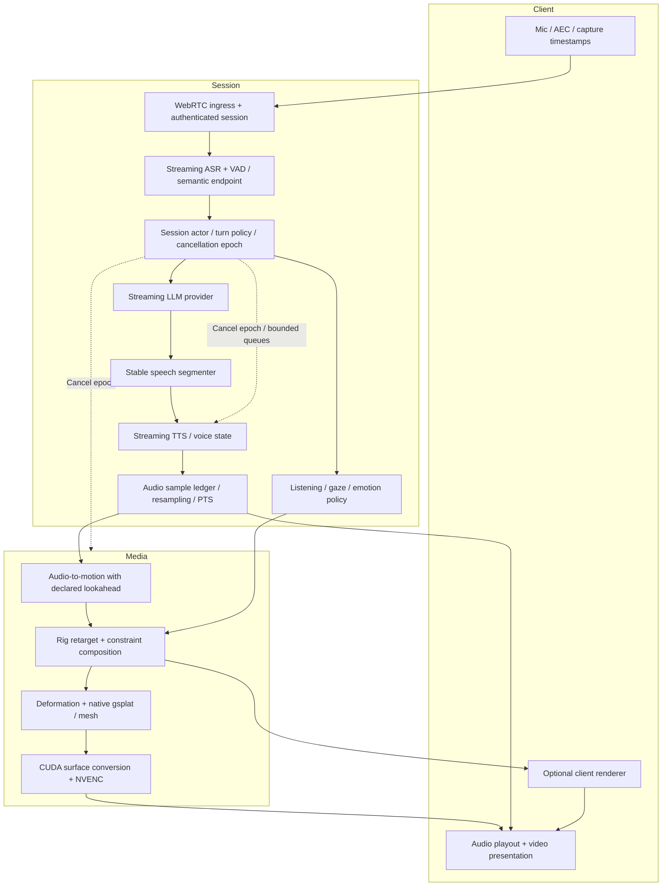
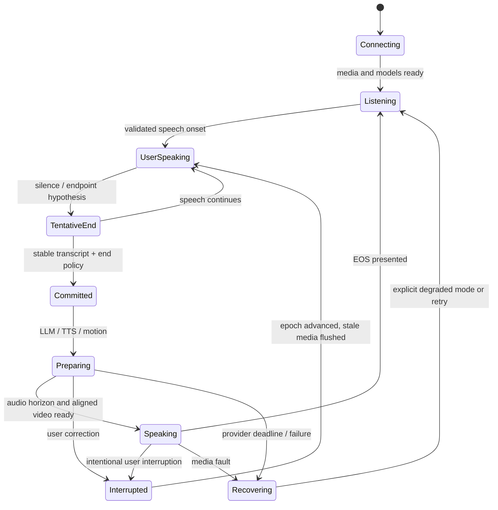

# TalkingHeadAvatar V2 — Research and Build Plan

**Status:** P00/P01 are implemented; P02 retains open quality/latency findings; P03 awaits real avatar/Claire inputs; P04's local browser audio reference runs with measured latency shortfall and unqualified speaking-video/human gates. **Qwen3-TTS is selected by the user**. Follow the [implementation status](docs/v2/IMPLEMENTATION_STATUS.md) for actual code and evidence; quality, latency and later product gates remain open.
**Model survey cutoff:** October 25, 2026. **Deployment scope revision / additional research:** October 26, 2026.  
**Audited V1 commit:** `54b4f171a9bb193a6b648b8015fba6ba295368f0`.  
**Target development hardware:** RTX 4070 Ti SUPER, 16 GB, Ryzen 5 7600X, 32 GB RAM, Fedora Linux.  
**Authority:** this document supersedes V1's implementation plan for **new V2 work**, while preserving V1.

## Reading map

| Artifact | Purpose |
| [Start implementing: P00–P09](docs/v2/IMPLEMENTATION_PHASES.md) | Ordered Codex task prompts, concrete outputs, prerequisites and acceptance checks |
| [Implementation status](docs/v2/IMPLEMENTATION_STATUS.md) | Current phase, persistent checkpoint and actual evidence |
|---|---|
| [Complete E2E specification](docs/v2/E2E_IMPLEMENTATION_SPEC.md) | Product journeys, selected stack, APIs, persistence, worker ownership and browser behavior |
| [Deployment and release](docs/v2/DEPLOYMENT_AND_RELEASE.md) | Packaging, network, readiness, operations, rollout, restore and release gates |
| [Implementation backlog](docs/v2/IMPLEMENTATION_BACKLOG.md) | E00–E20 work packages, dependencies and J01–J11 acceptance journeys |
| [Deployment research](docs/v2/DEPLOYMENT_RESEARCH.md) | New source findings, corrected LAM rights, native publishing and framework decisions |
| [V1 audit](docs/v2/V1_AUDIT.md) | Actual call graph, findings, retain/replace decisions, migration evidence |
| [Research evidence](docs/v2/RESEARCH_EVIDENCE.md) | Mandatory candidates, stronger alternatives, licenses, primary sources and uncertainty |
| [Independent model quality and selection](docs/v2/MODEL_QUALITY_BENCHMARKS.md) | User evaluations, benchmark scores and limitations, revised model priorities and Q0 comparison gate |
| [Validation protocol](docs/v2/VALIDATION_PROTOCOL.md) | Repeatable latency, synchronization, quality and concurrency procedures |
| [Local probe script](docs/v2/benchmarks/audit_probe.py) / [results](docs/v2/benchmarks/local-audit-2026-10-25.json) | Narrow observed V1 execution measurements |
| [Repository snapshots](docs/v2/repository-snapshots.json) | Source revision anchors at the cutoff |
| [Agent environment](docs/v2/AGENT_ENVIRONMENT.md) / [AGENTS.md](AGENTS.md) | Persistent implementation conventions and repo-local skills |

Evidence labels throughout: **observed**, **independent human evaluation**, **independent reproduction**, **practitioner report**, **source-inspected**, **author-reported**, **proposed target**, **projection**, or **unresolved**. A target is not a benchmark result. An author-run user study is still author evidence.

**October 26 policy revision:** prioritize independently measured quality and actual usage evidence. Noncommercial models are eligible for the primary research stack; commercial permission is neither a quality score nor a research shortlist filter. Keep exact license/provenance records and satisfy applicable research access terms; defer commercial-distribution clearance to a later release profile. Consent and asset authorization remain required. The linked quality report supersedes earlier commercially filtered model priorities.

---

## 1. Executive decision

Build a **complete deployable avatar application** around a streaming conversational control plane and an independently scheduled avatar media plane. Completion includes enrollment/consent, the browser UI, real inference, authenticated sessions, packaging, operations, revocation and recovery—not only the timing demonstration. The linked E2E specification and backlog are normative for these details.

The primary **integration baseline** is an explicit facial rig driving deformable 3D Gaussians, with a mesh fallback and optional learned residual. This is a scheduling/control choice, not an independently established visual-quality winner. Reuse research-eligible GaussianAvatars/VHAP/FLAME assets and adapters where they accelerate validation; compare EmoTaG and LAM without a commercial-license filter. Native **gsplat** remains the intended portable renderer, but a clean enrollment/deformation rewrite is not a prerequisite to proving visual quality. Q0/G1 can replace this visual route.

Separate:

1. **Speech articulation:** start with Audio2Face-3D Claire and a deterministic timing reference. Compare StreamingTalker on a matched rig if the baseline fails its gate; no independent head-to-head winner is established.
2. **Conversational behavior:** listening, gaze, blinking, head movement and emotion, driven by dialogue state/prosody with strict bounds on speech interference.
3. **Rendering:** consume timestamped motion at a separately selected cadence; 30 FPS initially, optional 60 FPS client rendering.
4. **Conversation:** replaceable streaming ASR/LLM/TTS providers with cancellable per-session state.

**Use Qwen3-TTS as the initial and default TTS provider**, per the user’s implementation decision: `Qwen/Qwen3-TTS-12Hz-1.7B-Base`, X-Vector first and ICL as an explicit option. P02 qualifies the official offline reference and an actual incremental PCM backend; it does not compare or integrate other TTS families first. Keep CPU streaming ASR and initially CPU-hosted bounded-context Qwen3.5-4B LLM inference (or an explicitly configured remote LLM) so the 16 GB GPU can prioritize Qwen TTS and media. GPU LLM co-residency requires measurement. Model selection does not claim the streaming runtime, visual quality or latency is already validated.

**User selection fixes Qwen for implementation; quality/performance acceptance still requires evidence.** LiveAvatar is the first server visual-quality reference, EchoMimicV3-Flash a larger-GPU comparator, and FlashHead Lite a local feasibility challenger with reported mouth-quality weaknesses. Fish Drama 3/S2-Pro remain deferred research references; do not implement them before the Qwen vertical slice. These are profile-specific trial priorities, not measured full-stack winners. First prove synchronized output and blinded quality, then conversation and capacity. [Independent evidence, scores and Q0](docs/v2/MODEL_QUALITY_BENCHMARKS.md). Client motion streaming remains the long-term server-cost reduction route where device capability and asset privacy permit.

The selected deployment stack is React/TypeScript/Vite, FastAPI/PostgreSQL, a project-owned session actor with pooled inference, self-hostable LiveKit and a native CUDA/NVENC media publisher. LiveKit C++ v1.11.0 is the first pre-encoded publishing candidate; GStreamer is the fallback. This is a source-supported integration plan, not a tested binary combination. [Deployment evidence](docs/v2/DEPLOYMENT_RESEARCH.md).

### Most consequential findings

- **Observed:** both existing translator checkpoints fail the current loader. V1 is not a clean runnable reference even though selected unit tests pass.
- **Source-inspected:** V1 captures/polls in 2 s blocks, waits for a whole LLM response, and commonly generates complete TTS sentences. These dominate first-response risk.
- **Observed:** isolated warm HuBERT p95 is ~4.3 ms locally; avoid exaggerating its single-session cost. Its repeated context processing is still wasteful across sessions.
- **Source-inspected:** A2F Claire requires 260 ms of future audio; this must be earned by TTS generation or paid as playback delay.
- **Source-inspected:** several “streaming” releases are offline APIs or chunked file demos. Qwen's standard TTS wrapper explicitly lacks true streaming generation.
- **Research policy:** FLAME/GaussianAvatars, AVTR-1, Avatar Forcing, LAM and StreamingTalker remain eligible on quality and technical fit. Their distinct terms are recorded for research access and later distribution, not used to preselect a lower-quality permissive model.
- **Author-reported:** StreamAvatar's avatar startup alone is 1.2 s on two H800s. Large video models' high FPS does not prove sub-second conversation.
- **Unresolved:** there is no credible measured full-stack p95<1s result on this machine, no validated production avatar asset, and no observed V2 session-capacity figure.

Detailed evidence and links are in the [research ledger](docs/v2/RESEARCH_EVIDENCE.md). The central risk is achieving **photorealistic mouth quality and natural endpointing together with the latency budget**, not merely displaying 30 frames per second.

## 2. Product scope and success criteria

### 2.1 Supported profiles

| Profile | Initial scope | Latency commitment |
|---|---|---|
| Local development | One warm English session, 512×512 at 30 FPS, consented enrolled avatar, local audio/virtual camera; CPU ASR, GPU Qwen TTS, CPU local LLM or explicitly configured remote LLM | Measure first; target same warm first-response budget, no promise from fit estimates |
| Server reference | One browser participant per session, region-local RTT≤40 ms, stable ≥5 Mbps downlink, headset/AEC, 512² at 30 FPS; worker pools and preloaded assets | Proposed first meaningful audiovisual response p50≤650 ms, p95<1000 ms (engineering target 950 ms), p99≤1500 ms |
| High quality | Higher resolution, expensive TTS/video model, broad head motion | Separately advertised latency/capacity; never pooled into low-latency claims |
| Client-rendered | Downloaded consented rig/asset; audio plus motion; supported desktop/mobile capability test | Reduces server render/encode latency, but local frame/thermal/asset-startup measurements still required |
| Degraded | Audio+static image or simple mesh, explicit UI status | Preserve understandable speech and cancellation; do not silently claim visual SLO |

The primary warm-session benchmark uses a **predeclared natural conversation mixture**, not only easy short questions. Include intra-turn pauses, hesitations, short questions, long utterances, corrections, accents and barge-ins. External tool/retrieval waits, first enrollment, and cold model loading are separate cohorts with their own distributions. A failed warm turn stays in the warm denominator.

Network bounds, language/domain, avatar resolution, model versions, context length, active session count and endpoint policy must accompany every SLO statement. Under loss, high RTT, overload, ambiguous turn completion or cold cache, the sub-second target may fail. Do not “fix” this by counting an idle blink, an irrelevant filler, or an early cutoff as a response.

### 2.2 Timing definitions

Let **t0** be the last acoustic sample of the user's completed turn at the **client capture clock**, determined by an offline annotation or test fixture. Let **tA** be the first audible, useful response speech at client presentation. Let **tV** be presentation of the first correctly aligned response-speaking frame. Then:

- **First audiovisual response:** `max(tA,tV)-t0`, with alignment within the specified skew tolerance. Report audio-only latency too.
- **Endpoint delay:** decision-to-commit minus annotated speech end; includes required silence and ASR/semantic confirmation.
- **ASR availability:** audio-sample capture to partial/final transcript emission; report word-finalization age and revision rate separately.
- **LLM first useful output:** committed prompt/version to enough stable, speakable text for the first segment. TTFT alone is insufficient.
- **TTS TTFA:** first accepted text segment to first playable PCM, including any text/codec buffering. Also measure time to first **motion-eligible audio horizon**.
- **Ongoing motion delay:** source audio sample availability to corresponding motion becoming ready. Split necessary future context, queue wait and model compute.
- **Render latency:** motion-ready/selected PTS to completed pixel surface; report GPU kernel service time and queued wall time separately.
- **Presentation skew:** video content time minus audio content time **at presentation**, with sign convention stated.
- **Complete-answer time:** t0 to last audible answer sample and corresponding final frame. It includes answer duration and interruptions; it is not expected to be under 1 s.
- **Startup:** process launch→model-ready, avatar request→asset-ready, WebRTC connect→playout-ready. A warm pool does not erase these costs.

Measure from annotated final speech, not server-side VAD event or LLM request time. Cross-machine clocks require an uncertainty estimate; client loopback/reference instrumentation is preferred for the final claim.

### 2.3 Quality and reliability targets

Proposed launch gates, to be calibrated against real reference footage:

- Lip-sync presentation error: absolute p95≤40 ms, p99≤80 ms; no sustained>80 ms deviation for>250 ms.
- Render delivery: 30 FPS target; ≥99% frames within their presentation deadline in the reference profile; stalls>100 ms counted separately.
- Barge-in: from onset of an intentional interruption to last audible stale speech p95≤200 ms, p99≤350 ms. Report false interruption/cutoff rates alongside this.
- Premature turn commits: ≤2% on the predeclared pause/hesitation set; false interruption≤2% on backchannel/noise fixtures. Human annotation required; these thresholds are product targets, not assumed model performance.
- No silent audio-chunk deletion, no cross-session state leakage, bounded memory over an 8 h soak.
- Human visual quality: reference-assisted rubric for identity, lips/teeth, eyes, head motion and temporal stability; proposed median≥4/5 and no dimension below 3.5/5 on the initial test set. Report confidence intervals and face-specific failures rather than one average.
- A new optimization must preserve visual/audio quality within the noninferiority margins in the validation protocol.

## 3. V1 disposition and migration

The [audit](docs/v2/V1_AUDIT.md) is the evidence source. Summary:

| Retain | Optimize / adapt | Replace / remove |
|---|---|---|
| V1 as immutable research reference; lawful source recordings/calibrations; useful pure tests; renderer-owner idea; virtual-camera sink concept | Explicit old checkpoint importer, text cleanup, offline HuBERT reference, debug UI isolation, RGB quantization before CPU copy for CPU sinks |2s capture/polling, rolling transcript dedup as turn logic, complete-response LLM flow, fake TTS streaming, unclocked queues, arbitrary motion-channel coercion, old production renderer/tracker licensing assumptions, PCA blinks, unverified GeoAvatar patches |

**Migration order:**

1. Inventory/hash assets and provenance; recover only those currently present. ARTIFACTS.md is historical.
2. Freeze legacy environment separately. Never replace its dependencies globally to make V2 install.
3. Add a read-only legacy translator importer in the future implementation milestone; map old names exactly, compare tensors, require rig/feature metadata. Do not fix with silent strict=False.
4. Export a **canonical V2 asset** only with a known coordinate frame, topology hash and lawful rights. Old FLAME→Open conversion is mathematical conversion, not retroactive relicensing.
5. Rebuild time-aligned features/splits for any reused data. Preserve original checkpoints and write new versioned artifacts.
6. Make research model adapters explicit in the selected profile, including NC dependencies. Keep provenance and dependency boundaries so a later commercial bundle can be qualified separately; do not make clean-room replacement a prerequisite for research validation.
7. Retire V1 live orchestration after V2 passes same-fixture regression and user quality gates; do not delete the baseline during research.

**Observed audit validation:**16 selected tests passed; full test collection failed on four imports due missing iopath/plyfile/tyro. Both checkpoint loads failed. Cached HuBERT and conversion microbenchmarks ran without downloading weights. No complete audiovisual quality/performance benchmark was possible.

### ADR-016 — Qwen3-TTS is selected for immediate implementation

**Status:** accepted user choice, October 26; runtime/performance qualification pending.  
**Decision:** implement Base 1.7B, X-Vector first, optional ICL; official Python offline reference and one verified incremental backend. Follow P00–P09; use the persistent status ledger between sessions.  
**Consequence:** Pocket/Kokoro/Fish comparisons are deferred and Q0 no longer blocks TTS integration. Q0 still qualifies runtime parity, human quality and expensive visual/training decisions. Do not silently substitute a model or claim author benchmarks as measured performance.  
**Runtime gate:** qualify the native C++ Base route on Fedora first; X-Square Base is a fallback with experimental cloning status. Exact source, tokenizer/conversion hashes, cancellation, memory and stream behavior must pass P02. [Phase guide and source evidence](docs/v2/IMPLEMENTATION_PHASES.md).

## 4. Architecture Decision Records

### ADR-001 — Separate conversation, motion and rendering

**Status:** accepted.  
**Decision:** typed streaming provider interfaces, one session actor, media clock independent of LLM cadence.  
**Reason:** turn-taking, cancellation, media deadlines and model replacement need stable contracts.  
**Rejected:** one giant run_demo process with untyped queues; tightly coupled speech/video model as the only backend.  
**Consequence:** modest adapter work; fault boundaries and timing become testable. A joint speech backend remains possible behind the same audio/control events.  
**Revisit:** a joint model passes tool/control, latency, rights and capacity tests with a clear quality advantage.

### ADR-002 — Explicit rig/Gaussians is the provisional integration baseline

**Status:** provisional visual choice; independent quality comparison Q0/G1 open.  
**Decision:** canonical rig and deformed Gaussians, learned residual optional. Native gsplat is the portable target; research-eligible vendor renderers/trackers may establish the first quality baseline.  
**Reason:** low-dimensional control, reusable identity assets, independent render cadence, predictable cancellation and client portability. [Research comparison](docs/v2/RESEARCH_EVIDENCE.md#5-representation-comparison-and-selected-direction).  
**Rejected as local default:** large video configurations exceeding 16 GB; unreleased Instant Expressive; unchanged V1 orchestration; assumption that 2DGS alone solves anatomy. Noncommercial status is not a rejection reason.  
**Consequence:** compare research implementations before funding clean enrollment/deformation work. No independent visual winner is established.  
**Revisit:** a challenger wins a blinded matched comparison and meets the selected profile's timing/resources. LiveAvatar may win a server quality tier without qualifying for local low latency.

### ADR-003 — Articulation and behavior have separate control authority

**Status:** accepted.  
**Decision:** lower-face speech articulation is protected; expression/behavior may affect upper face, gaze, neck and bounded prosodic head motion. Controlled lower-face emotion is composed through calibrated masks/constraints.  
**Reason:** speech alignment is near-deterministic while listening gestures are ambiguous. This separation reduces failure coupling and supports a safe neutral fallback.  
**Rejected:** a single unconstrained audio regression model predicting all absolute channels; arbitrary PCA blink axis; random gestures interpreted as emotion.  
**Consequence:** need a retarget/calibration profile, conflict arbitration and combined-output quality tests.  
**Revisit:** an expressive end-to-end motion model demonstrates better quality without lip-sync regression or unpredictable latency.

### ADR-004 — Motion choice requires a matched quality comparison

**Status:** provisional baseline, no independent quality winner.  
**Decision:** implement Claire 2.3.1 SDK/ONNX first. Use StreamingTalker on the same retargeted rig if the baseline fails; LAM-A2E is a subsequent challenger. Do not require multiple motion integrations before P03. No A2Emotion dependency initially.  
**Reason:** Claire gives an inspectable integration baseline; StreamingTalker's author geometry scores justify testing, not automatic promotion. Research eligibility includes NC/register-to-use models, with actual access requirements recorded.  
**Rejected:** selecting A2F solely because of deployability terms; selecting StreamingTalker solely from its paper; preserving V1's speaker-specific transformer by default.  
**Consequence:** **260 ms future audio** and nontrivial retargeting. A2F geometry is not FLAME coefficients.  
**Go/no-go:** first-motion-eligible audio and retargeted lips meet gates. Otherwise choose licensed causal articulation/phoneme path, or accept a separately labeled higher-latency profile; do not crop future context blindly.

### ADR-005 — Audio presentation clock governs all media

**Status:** accepted.  
**Decision:** integer sample positions, generation epochs, mapped media PTS, continuous output timeline; audio playout is the master.  
**Rejected:** completion-time motion timestamps, independent sleep loops and per-consumer drop-oldest speech queues.  
**Consequence:** sample accounting/resampling/EOF and cancellation need explicit tests. RTP and device clocks are mapped rather than assumed equal.  
**Revisit:** transport-level clock facilities can replace plumbing only after equivalent guarantees.

### ADR-006 — Server-rendered WebRTC first; client rendering as scale tier

**Status:** accepted.  
**Decision:** native media worker→GPU conversion/NVENC→WebRTC. First proof may use one explicit CPU copy; production optimization must demonstrate actual eliminated transfers. Client mesh/GS consumes the same motion contract later.  
**Reason:** server output gives controlled initial quality and supports virtual camera; client rendering lowers recurring render/encode cost but expands device/testing/privacy scope.  
**Rejected:** MJPEG/file preview as production transport, claiming Python frame publishing is zero-copy, building a new SFU.  
**Consequence (revised October 26):** use LiveKit as the selected media transport. Its released C++ pre-encoded source is the first native integration candidate, with GStreamer LiveKit sink as fallback. A stock Python raw-frame path remains a declared-copy baseline. Exact A/V timing, receiver cancellation and SDK/runtime interoperability remain gates; see ADR-011 and the deployment research.

### ADR-007 — Resource pools, not one full model stack per user

**Status:** accepted.  
**Decision:** share immutable weights/identity assets, isolate per-session state, admission by measured SLO/memory/encoder capacity. On one GPU combine motion/render ownership; keep LLM worker separately controllable.  
**Rejected:** load all models per process/session, train during serving, unbounded batching, swapping active avatars every frame.  
**Consequence:** batching must respect deadlines and session identity; CPU/GPU budgets explicit.  
**Revisit:** dedicated per-tenant workers where compliance or workload isolation requires it.

### ADR-008 — Streaming provider capability is verified by contract tests

**Status:** accepted.  
**Decision:** provider declares incremental text input, incremental audio output, context/lookahead, cancel granularity and flush semantics. Distinguish chunked delivery of complete output.  
**Reason:** inspected Qwen/Chatterbox/demo APIs differ from headline streaming claims.  
**Consequence:** provider choice remains configurable; model/backend pair is the unit of evaluation.  
**Rejected:** implementing one misleading synthesize_streaming method across batch providers.

### ADR-009 — Research selection and commercial distribution are separate decisions

**Status:** revised October 26 per project research scope.  
**Decision:** promote using independent quality evidence and measured profile feasibility. NC models may be primary research components. Pin code/weights/assets and record terms now; qualify commercial distribution later if requested.  
**Rejected:** commercial-license filtering of research candidates; treating public download or a root license as universal rights; renaming author benchmarks as user validation.  
**Consequence:** research deployment can be qualified before commercial clearance. Actual access conditions, consent, attribution and reproducibility still apply. No broad root license is silently applied to existing work. [Selection policy and Q0](docs/v2/MODEL_QUALITY_BENCHMARKS.md).

### ADR-010 — Optimize measured bottlenecks in stages

**Status:** accepted.  
**Decision:** establish eager/CPU-copy reference, then remove repeat computation/transfers, compile stable modules, evaluate quantization and bounded batching.  
**Rejected:** TensorRT/CUDA graphs everywhere before timeline correctness; speculative LLM and TTS unlimited retries; custom persistent kernels before traces.  
**Consequence:** fewer initial components, trace-backed optimization, parity tests on every promoted path.

### ADR-011 — Use released transport primitives and preserve application timing

**Status:** accepted direction, integration gate open.  
**Decision:** native NVENC → LiveKit C++ encoded source, with audio/video published under the same media participant. Handle complete access units, timestamps, keyframe/rate feedback and explicit lifetimes. GStreamer LiveKit integration is the first fallback.  
**Reason:** v1.11.0 supplies the missing publishing interface; no new RTP/SFU or mandatory transcoding service is needed.  
**Rejected:** assuming all SDKs accept device surfaces; treating AVSynchronizer's timestamps as receiver presentation; claiming zero-copy when encoded bytes are copied.  
**Gate:** real browser loopback, cancel-resume, repeated attach/detach and no raw-frame readback evidence. [Sources](docs/v2/DEPLOYMENT_RESEARCH.md).

### ADR-012 — Own session policy; reuse transport and reviewed adapters

**Status:** accepted.  
**Decision:** one project-owned session actor, LiveKit RTC clients, shared speech/media pools. Evaluate LiveKit Agents/Pipecat as adapter/reference sources rather than nesting orchestration frameworks.  
**Reason:** GPU pooling, sample/epoch contracts and deadlines must remain explicit. Default per-job process behavior must not replicate all models.  
**Rejected:** wholesale OpenAvatarChat fork as proof of latency; two turn managers or two audio pacers.  
**Revisit:** a framework passes the same contracts and demonstrably lowers maintenance cost.

### ADR-013 — Durable product state; ephemeral media state

**Status:** accepted.  
**Decision:** FastAPI/PostgreSQL metadata and leased enrollment jobs; immutable blob assets; fenced session reservations; no per-frame database or durable queue.  
**Reason:** enrollment retries, consent revocation and recovery require durable records; live audio requires bounded direct streams.  
**Rejected:** storing live PCM in Redis/database jobs; introducing a large workflow stack before needed.  
**Consequence:** idempotency, outbox events, leases, schema migrations and tombstones become release requirements.

### ADR-014 — Receiver-safe interruption is a release gate

**Status:** accepted; transport method must be qualified.  
**Decision:** local mute plus server epoch cancellation, followed by a proven receiver-safe resume boundary. Track replacement is the conservative fallback where old buffers cannot be flushed.  
**Reason:** sender queue clearing cannot remove already received media. Video metadata does not provide exact audio sample acknowledgment.  
**Rejected:** unmute immediately after server acknowledgment and assume no stale words.  
**Consequence:** measure interruption suppression and resume delay separately; unsupported profiles cannot claim reliable barge-in.

### ADR-015 — Complete lifecycle and operations define delivery

**Status:** accepted scope expansion.  
**Decision:** implement E00–E19 and required journeys J01–J10; client rendering E20/J11 remains optional. Preserve the staged visual/timing gates.  
**Reason:** a model demo is not a deployable conversational product.  
**Rejected:** marking the task complete after a mock/known-text slice, a Compose file without real models, or an API without enrollment/revocation/recovery.  
**Consequence:** revised whole-product effort, operator runbooks, deployment validation and real browser evidence; see the [backlog](docs/v2/IMPLEMENTATION_BACKLOG.md).

## 5. System architecture



### 5.1 Process and thread ownership

- **Session actor:** one logical owner of transcript, turn state, epoch, speculative generation and playback acknowledgments. CPU asynchronous loop; no blocking GPU/audio calls inside it.
- **ASR worker:** per-session encoder/decoder state, shared model weights; separate from mutable turn policy. CPU first, GPU pool option.
- **LLM worker:** persistent model server or local llama.cpp; per-session context/KV/state; streaming cancellation. No shared Python model invoked concurrently from arbitrary input threads.
- **TTS worker:** shared weights, separately keyed voice prompt/state, cancellable segment generation; bounded outstanding output seconds.
- **Media worker:** sole owner of CUDA motion contexts, rig assets, renderer buffers and encoder surface ring for its GPU. Internal streams/events; per-session motion state and per-avatar immutable assets.
- **Transport worker:** WebRTC session, RTP timestamps/RTCP, bandwidth adaptation, incoming audio. Native integration where zero-copy matters.
- **Enrollment worker:** offline isolated process/container. Never shares live GPU time without explicit maintenance/admission policy.

Logical boundaries do not require six microservices on day one. Local M1 uses a small Python coordinator, CPU ASR/turn workers, one separately controlled Qwen GPU worker and one media process; measure aggregate VRAM. Network RPC is introduced only where process isolation or pool scaling needs it.

### 5.2 Conversation state machine



- VAD proposes onset/pause; acoustic semantic model and stable transcript help commit. Start with 220–350 ms silence on confident complete turns, extend toward 700–1000 ms for ambiguous continuation. Tune from human-labeled fixtures, not latency alone.
- One speculative LLM request may start from a stable partial near likely endpoint. It must have a prompt-version ID. Discard if transcript changes. No speculative tools with side effects; no audible speculative response before turn commitment.
- Initially disable speculative TTS. Enable only when wasted-work and cancellation tests pass; cap one speculative generation and one bounded audio horizon.
- During avatar speech, AEC operates on the actual played audio reference. A brief acknowledgment can be classified as backchannel; sustained/intentional speech interrupts. A client-side fast interruption gate suppresses already queued stale playback while server cancel propagates.
- On interruption increment generation_epoch, stop accepting old tokens/PCM/motion, cancel provider work at supported boundary, discard queued stale media, and ramp to current neutral/listening pose. Preserve only **actually presented** assistant words in conversation history.
- If user changes topic during preparation, cancel and recompute from the latest committed transcript. Do not append both superseded and corrected answers.
- If overlapping human speakers cannot be separated, expose ambiguity/request clarification. Do not attribute words confidently to the wrong participant.
- Silence/noise does not produce repetitive filler. Timeout/failure feedback is explicit and counted separately from useful-response latency.

## 6. Component interfaces and invariants

Use versioned protobuf messages for interprocess/network control and typed Python models at the application boundary. In-process typed queues are sufficient for M1. Media payloads use local shared memory/device surfaces where possible; do not serialize full GPU tensors through JSON.

### 6.1 Required event schemas

| Event | Required fields and semantics |
|---|---|
| CommonEnvelope | schema_version, session_id, generation_epoch, turn_id, sequence_no, trace_id; source monotonic timestamp only with named clock_id |
| InputAudio | capture_sample_index, sample_rate, channels, sample_count, PCM reference, capture_clock_id, discontinuity flag; exact index of first sample |
| ASRUpdate | hypothesis_id, revision, text, word sample spans/confidence if supported, stable_prefix_length, is_final; final does not necessarily mean end of human turn |
| TurnCommit | committed hypothesis/revision, annotated-compatible endpoint estimate, policy version, confidence/reason; no wall-clock-only alignment |
| TextSegment | segment_id, stable spoken text, language, voice/style request, is_last; ordered irreversible speech segments |
| AudioChunk | segment_id, native_rate, start_sample, sample_count, PCM handle, EOS/discontinuity, optional timing hints; contiguous within epoch |
| SpeechTimingHint | source/provider revision, phoneme/word/codec identifier, start/end sample, confidence, semantics; explicitly optional |
| MotionFrame | rig_schema_id + hash, audio_sample_position, sample_rate/timebase, absolute/delta convention, expression/viseme map, jaw/neck/head/eye transforms, confidence, valid_until |
| BehaviorIntent | behavior_id, start/end PTS, priority, bounded intensity, allowed channel mask, seed; no direct unvalidated LLM float arrays |
| VideoSurface | presentation PTS, duration, dimensions, format/colorimetry, device_id, surface_handle, completion fence, epoch; ownership release callback |
| PlaybackAck | last_played_audio_sample, last_presented_video PTS, clock estimate/uncertainty, underruns/dropped frames; not merely packet receipt |
| Cancel / Drain / Reset | epoch, reason, last permissible sample PTS, acknowledgment; EOF and cancellation are distinct |
| ProviderCapabilities | rates, frame/chunk sizes, left context, right context, incremental input/output, cancellation granularity, model revision, peak-memory envelope |

**Invariants:**

1. Audio sample spans do not overlap or leave unexplained holes. EOS flushes resampler/filter tails with an explicit valid duration; padded model context is not playable speech.
2. Outputs from an older epoch can never be presented after cancel acknowledgment. Buffers already inside a device/network jitter queue require a measured flush/mute strategy.
3. Motion can be resampled, but its timestamps cannot be replaced by completion times.
4. Coordinate systems, units, neutral pose, blendshape ordering, quaternion convention and model basis are negotiated through rig_schema_id. Reject mismatch; never pad/truncate silently.
5. Resource ownership lasts until encoder/render consumption completes; a CUDA event is not a lifetime extension by itself.
6. Immutable weights may be shared; caches, voice state, emotion state, RNG state and sample cursors are per-session unless explicitly keyed and proven safe.
7. All deadlines use monotonic clocks. UTC is for logs/provenance, not real-time scheduling.

### 6.2 Canonical avatar manifest

An `avatar.json` manifest should include:

```json
{
  "schema_version": 1,
  "avatar_id": "opaque-id",
  "asset_revision": "sha256:...",
  "rig": {
    "schema_id": "project-rig-v1",
    "topology_hash": "sha256:...",
    "basis_hash": "sha256:...",
    "units": "meters",
    "rotation": "quaternion_xyzw",
    "handedness": "right",
    "pose_semantics": "absolute_from_canonical"
  },
  "appearance": {"representation": "attached_3dgs", "asset": "identity.safetensors"},
  "retarget": {"profile": "a2f-claire-to-rig-v1", "revision": "sha256:..."},
  "limits": {"max_gaussians": 100000, "supported_yaw_degrees": [-30, 30]},
  "provenance": {"consent_record_id": "private-reference", "license_manifest": "licenses.json"}
}
```

This is a proposed schema example, not an existing asset or measured 100K-point requirement. Store sensitive consent details in protected storage, not the public manifest. Include camera intrinsics/extrinsics and color/exposure metadata in actual enrollment manifests. Prefer safetensors/validated numeric arrays for weights; trusted legacy pickle is restricted to isolated imports.

### 6.3 Provider API behavior

A provider supports `open_session(config)`, `push(event)`, asynchronous `outputs()`, `flush()`, `cancel(epoch)`, and `close()`. Providers that cannot incrementally accept text must say so. Segmenter produces small semantically stable clauses, initially targeting 4–12 words with maximum wait 120 ms **after useful words begin arriving**, then adapts to punctuation and TTS needs. Avoid emitting a bare first token, a half-number or a broken abbreviation just to improve TTFA.

A cancellation acknowledgment has a deadline and reports the last compute/output boundary stopped. The coordinator may mute locally immediately, but must still reclaim remote work. Model failures carry typed retryability and resource-failure reasons.

## 7. Motion, behavior and renderer design

### 7.1 Articulation route and A2F retargeting

First compare:

1. A2F Claire regression through the actual SDK/ONNX runtime.
2. Legacy HuBERT+translator with repaired research importer as a baseline only.
3. A deterministic viseme/phoneme timing baseline where a TTS provider genuinely supplies durations; otherwise use a small causal audio articulator experiment later.
4. After a baseline quality failure, StreamingTalker on a matched retargeted rig; LAM-A2E as a subsequent challenger. Independent blinded ratings qualify visual claims; published vertex errors do not establish rendered mouth quality. This challenger work does not block the first functional P03 integration.

Do not confuse a text pronunciation dictionary with real synthesized timings. Neural TTS codec tokens or hidden states are **not** pretrained HuBERT features. Reusing them requires a matching trained adapter and language/voice generalization tests.

A2F produces its own geometry/blendshape/jaw/eye representation. Fit a constrained retarget profile:

- Establish canonical neutral geometry and landmark correspondences.
- Sample a calibration set covering bilabials, fricatives, vowels, jaw opening and asymmetric expressions.
- Solve regularized bounded coefficients to match mouth/face geometry; keep jaw rigid transform distinct from lip blendshapes.
- Validate closed-lip contacts, teeth visibility, tongue limits, eye rotations and neutral identity.
- Store mapping/calibration revision with each rig; use generic mapping plus per-avatar corrections.
- Reject mappings that preserve coefficient shape but visibly break articulation. Test on held-out phonetic sequences.

**Lookahead accounting:** for first frame at time 0, Claire needs audio through +260 ms plus any chunk alignment. If TTS can generate≥300 ms useful audio before presentation in the allotted wall time, render ahead and start aligned playback. If not, wait and count it. For external live human audio the 260 ms future context is unavoidable latency. Distillation to a causal model is a later research task, not a switch.

### 7.2 Behavior composition

Behavior state derives from listening/speaking status, elapsed silence, turn confidence, prosodic features and optional validated semantic emotion. Do not infer sensitive personal emotional/mental states as facts.

Channel authority:

- Articulation owns jaw/lip closure and phoneme-sensitive lower face.
- Behavior owns gaze target, blink, head/neck gestures, upper-face affect.
- A constraint layer blends bounded emotion residuals and resolves collisions; neutral and cancellation have highest priority.
- Use anatomically calibrated blink/eye channels and minimum inter-blink intervals; distinguish saccades from smooth gaze changes.
- Per-session seeds make traces reproducible without identical synchronized blinks across users.
- Head gestures sampled at 5–10 Hz intent updates, continuous constrained trajectories; articulation 25–50 Hz initially, render 30 Hz.
- Speech and motion can overlap user listening; turn policy—not random amplitude—controls acknowledgment gestures.
- An optional learned residual receives prosody/dialogue features and a strict amplitude/frequency budget. Disable it without breaking speech.

### 7.3 Representation and deformation

Use canonical Gaussian centers, scale/covariance, opacity and appearance coefficients, attached to an explicit facial surface by barycentric/skin weights. Pose deformation must transform centers **and orientation/covariance** consistently. Mouth/teeth/eyeballs require dedicated geometry and attachment groups; a centroid shift is not jaw rotation.

Start with small SH degree and bounded point count; determine quality/latency frontier on 512². Keep canonical per-avatar assets resident; current motion and bounded residual state are per-session. Do not store entire tracked training sequences in live GPU memory.

After Q0, a portable renderer can use an independently implemented surface-attachment transform with native gsplat. Before that, reuse a research-eligible renderer to validate quality. Copying code into a new file does not change its terms; preserve provenance. This is an explicit portability option, not mandatory clean-room work for the research milestone.

2DGS is a candidate if its surface consistency improves facial quality at equal latency, but requires its own mouth/occlusion/lighting and native-backend license evaluation. Hybrid mesh+neural residual is adopted only if it improves held-out identity/mouth metrics without flicker or budget violations.

### 7.4 Cadence and interpolation

Motion model cadence is independent of output FPS. Interpolate bounded scalar controls and use quaternion interpolation for rotations at the **audio presentation time**. Keep at most one motion interval of interpolation lookahead; count it in startup budget. Near discontinuities (cancel/reset) use explicit transition rules rather than interpolating across generations.

Avoid generic video-frame interpolation in M1: it adds compute and can smear lips/teeth. At overload, reduce rendering 30→24→15 FPS while preserving motion/audio sampling, then choose mesh/static fallback. Quality profile changes are explicit events.

## 8. Latency architecture

### 8.1 Warm reference budget

The following are **design allocations**, not measured component quantiles. They make a plausible critical-path hypothesis that M1/M2 must falsify. Individual stage p95 values cannot be added to statistically predict joint p95; correlated contention can make the total worse.

| Critical-path part | Median allocation ms | Tail allocation ms | High-tail allocation ms | What it includes |
|---|---:|---:|---:|---|
| Last captured audio→committed turn |260|350|550|10–20 ms packetization, uplink, overlapping streaming ASR completion and silence/semantic endpoint |
| Commit→first useful stable text |90|160|280|LLM queue/prefill/initial tokens plus segmentation; speculative credit only when measured |
| Text→first motion-eligible PCM horizon |160|240|400|TTS queue/first PCM and enough generated future audio for selected motion model |
| Articulation + retarget |5|15|25|Queue and completed compute for first pose |
| Deformation + render |5|12|20|Selected PTS→completed GPU surface |
| Color conversion + encode |4|8|15|Including encoder queue, no B-frames/lookahead in reference mode |
| Downlink + jitter + decode + presentation |50|80|140|Receiver buffering and audio/video presentation alignment |
| Contingency |76|85|70|Scheduling/network variance not already included |
| **Budget envelope** |**650**|**950**|**1500**|Hypothesis corresponding to proposed p50/p95/p99 system targets |

Endpoint budget example: 20 ms capture packet +20 ms one-way transport +max(ASR residual, ~300 ms silence/semantic completion) is roughly 350 ms after small processing overhead. ASR normally runs during speech; it is not a second full transcription after silence. Long uncertain pauses may need a larger endpoint interval and miss the budget. This is visible in the distribution and false-cutoff tradeoff.

The 240 ms TTS horizon allocation remains aggressive with selected Qwen and 260 ms motion lookahead. Architecture-level TTFA and backend cache-hit benchmarks do not prove it. Measure first 300–400 ms playable output as well as first byte. If it fails, profile the Qwen runtime, qualify a smaller/quantized same-family variant or separate Qwen worker, or evaluate lower-lookahead articulation. Do not remove endpoint patience or silently switch TTS families to hide downstream latency.

### 8.2 Ongoing and cold paths

| Metric | Proposed objective | Limitation |
|---|---|---|
| Media steady-state service | Render+encode p95≤20 ms at 512² and 30 FPS, reference admitted load | Full GPU contention, surface lifetime and queueing included |
| Motion compute after required input ready | p50≤5 ms, p95≤15 ms, p99≤25 ms | A2F/retarget unmeasured |
| Live source audio→motion with Claire | p95≤320 ms, including 260 ms future context and scheduling | Not zero-latency; TTS pre-generation can only move waiting before playback |
| Presentation skew | p95≤40 ms, p99≤80 ms absolute | Actual device/browser playout, not server send timestamps |
| Last-answer timing | First response + actual spoken duration + any stalls | Long answers naturally take many seconds |
| Warm avatar attach | Target≤2s after network asset already cached | Measure load/initialization separately |
| Cold startup | Report process/model/engine/asset/connect phases; target ready≤30s from cached artifacts initially | No sub-second commitment; TensorRT engine compilation and first downloads excluded from warm serving and reported separately |

No measured V2 cold-start value exists. Warmup is a readiness barrier; workers cannot receive sessions until all selected profiles and encoder surfaces are ready.

### 8.3 Overlap and speculation

ASR/VAD continuously consume input. Tentative user endings may trigger one bounded LLM speculation. After commit, text segments, TTS and motion run incrementally. Once the first aligned horizon is ready, audio playback begins while later text/audio/motion/render jobs continue.

The critical path is:
`turn_commit → useful_text → sufficient_PCM → motion → pixels → encode → presentation`.
Overlap reduces later work and some pre-commit work; it does not erase mandatory dependencies. A high-TTFA voice or long kernel can dominate even when every component uses threads.

Speculative output is keyed by transcript revision and epoch. Charge wasted GPU time in capacity/cost results. Stop speculation under load before compromising committed speech deadlines.

## 9. Audio/video synchronization and recovery

### 9.1 One timeline

Maintain a 64-bit sample cursor for output audio in a canonical transport timebase (48 kHz for WebRTC), with exact mappings to native TTS sample rates and 16 kHz motion input. Use a **stateful rational resampler** with retained filter history; record delay compensation and fractional sample phase.

A generation's logical sample 0 maps to a scheduled session presentation PTS. Audio chunks, motion frames and video surfaces refer to that mapping. Session RTP clocks remain continuous across generation changes; changing an epoch does not reset established RTP timestamps. If safe cancellation requires replacing a track, its new SSRC/clock is explicitly mapped back to the session timeline; old track callbacks are rejected. RTCP sender reports and shared synchronization context align audio 48 kHz and video 90 kHz clocks. [RTP/WebRTC reference](https://www.rfc-editor.org/rfc/rfc8834.html).

For local playback use device callback timestamps/output latency, not time.sleep. For browser playback use receiver stats/presentation observations and reference capture; browser APIs may not expose an exact speaker sample cursor. Include that uncertainty and validate with external loopback.

### 9.2 Queues and backpressure

| Queue | Initial bound | Policy |
|---|---|---|
| Incoming audio |≤500 ms ring, timestamped | Never block capture callback; on overflow emit discontinuity/reset ASR and log lost span |
| ASR updates |Latest partial per hypothesis + ordered finals | Replace obsolete partials; never merge different turns |
| LLM text |≤2 committed speech segments ahead | Backpressure/token cancellation; do not accumulate a full response by default |
| Synthesized PCM ahead of playback |Target 300–500 ms; hard cap 1000 ms per epoch | Pause/cancel producer; no silent word deletion; minimum horizon depends on motion lookahead |
| Motion |Bounded~500 ms future PTS, latest useful history | Discard expired/stale epoch; interpolation only inside current epoch |
| Render surfaces |2–3 slots/session | Drop stale **video** before rendering/encoding; never overwrite an in-flight surface |
| Encoder/transport |≤2 video frames local queue initially | Congestion-aware bitrate/FPS reduction; no unbounded old frames |
| Debug/recording |Low priority, independent bounded queue | Drop debug frames; never stall speech/render |

These are initial tuning values, not a rigid promise. They must be jointly tuned: a 1 s prebuffer would make a 200 ms interruption target impossible unless the client can immediately flush/mute it.

### 9.3 Drift, packet loss and discontinuities

- Estimate mapping between output sample clock and monotonic presentation clock continuously. Use slow bounded resampling/clock correction for drift; never regularly skip audible words.
- Derive video PTS from the **audio presentation timeline**, not the last generated sample. A server renders ahead for the scheduled presentation deadline using the clock mapping and measured render/encode/transport lead; it must not render the currently audible pose and deliver it a network delay later. A client renderer evaluates its own current audio playhead. Repeat a recent frame briefly if needed; drop late frames rather than slow speech.
- Use RTP/RTCP congestion handling, Opus PLC/FEC where appropriate, and browser jitter buffers. A missing packet is not an instruction to shift all future motion.
- Server does not know every receiver's exact PLC waveform. For sustained loss>200 ms or unknown playhead, transition to neutral/still video and recover at a known PTS; mark degraded sync rather than claiming perfect alignment.
- On decoder reset/keyframe request, schedule an aligned IDR and preserve continuous audio timeline. Different viewers may have different playout latency; a client-rendered avatar must follow its own audio clock.
- Cancel messages travel on a reliable control channel with epoch acknowledgment; fast local mute handles propagation delay. Clear queued PCM and pending video, but also account for in-device buffers already committed.
- End-of-stream flush emits valid tail audio and final motion through its last real sample, then an idle transition. Model padding is discarded. Queue-empty is never interpreted as EOF.
- Network reconnect establishes a new mapping/epoch and discards old cache outputs; do not replay buffered stale speech.

Detailed fixtures and acceptance checks are in [VALIDATION_PROTOCOL.md](docs/v2/VALIDATION_PROTOCOL.md).

## 10. Model selection, data and enrollment

### 10.1 First experiments, not unconditional production selections

| Role | Initial candidate | Alternative | Promotion gate |
|---|---|---|---|
| Capture/AEC | Browser WebRTC audio processing; local callback with echo reference | Headset for local proof | Continuous 10–20 ms capture without self-transcription |
| ASR | CPU sherpa-onnx streaming English Zipformer | Nemotron 3.5 ASR; Qwen3-ASR for other languages | Accuracy, revision age and endpoint tails under concurrent CPU load |
| Turn detection | Silero VAD + SmartTurn v3, with explicit policy | Conservative VAD; manual push-to-talk for debugging | Natural-pause and false-cutoff gates |
| LLM | Qwen3.5-4B, quantized text-only llama.cpp backend | Existing Gemma GGUF; separate GPU or remote provider | First useful text tail allocation, context support and cancellation |
| TTS | **Selected: Qwen3-TTS-12Hz-1.7B-Base**, X-Vector first; explicit ICL option | Same-family runtime/precision/0.6B fallback only with recorded quality gate; other TTS families deferred | Actual PCM streaming, cancel/EOF, reference parity, horizon p95 ≤240 ms for low-latency tier, RTF <0.7, co-load memory |
| Articulation | A2F Claire 2.3.1 integration baseline | StreamingTalker after a measured failed gate; V1 reference, then LAM-A2E if needed | Matched rig/blinded lips/teeth comparison; context, memory and timing measured |
| Behavior | Bounded state policy and prosody cues | Learned expressive residual after ablation | Better listening naturalness without articulation regression |
| Renderer | Rig/Gaussian integration baseline; research GaussianAvatars/EmoTaG eligible, native gsplat portable target | Conventional mesh; native 2DGS experiment | Q0 held-out identity/mouth quality, 512² at 30 FPS under admitted load |
| Enrollment | Consented footage; research-eligible VHAP/FLAME/LAM comparisons | Independent fitting route only after quality validation; Instant Expressive when artifacts exist | Provenance, topology, blinded held-out identity and fitting cost; no NC exclusion |
| Direct video | Server quality reference: LiveAvatar; local feasibility: FlashHead Lite | EchoMimicV3-Flash, Cui Avatar Forcing; separately qualified hardware | Q0 preference, mouth regressions, first output, memory, cancellation and soak per profile |

The research ledger supplies source and license details for these choices. A failed gate selects a fallback or changes an ADR. It does not justify changing measurement boundaries. If the local LLM runtime cannot support the selected model efficiently, use a smaller verified model or remote LLM for the media experiment and label that profile separately.

### 10.2 Training strategy

Do not pretrain a foundation model in M1/M2. Reuse research-eligible pretrained components and calibrate the rig mapping. Expensive training requires Q0/G1 evidence of a baseline failure and suitable data addressing it. Commercial clearance is deferred; actual research access and consent are still respected.

Potential later work:

- **Causal articulation student:** a stateful audio frontend and small causal transformer/TCN, 20 ms stride, with explicit 0/40/80 ms lookahead variants. Train using the same streaming feature regime used at inference. Supervise lip contact, jaw anatomy and temporal behavior rather than only all-face L1.
- **TTS feature adapter:** consume a particular provider's phoneme, codec or hidden-state features. Bind the adapter to the model revision; preserve PCM fallback. Test across speakers and languages before claiming generality.
- **Expressive residual:** condition upper face, gaze and head motion on both conversation streams and dialogue state. Requires consented dyadic listening data; constrain articulation interference.
- **Appearance residual:** a small expression/view-dependent deformation or color network. Reject unstable oral anatomy even if aggregate image metrics improve.
- **Personalized Gaussian fitting:** optimize canonical identity, cameras, appearance and deformation in stages. Treat teeth/eyes explicitly and regularize skin attachment. Store training state separately from the compact serving asset.

Record data revisions, initialization, split manifests, exact losses, GPU-hours, peak VRAM, validation curves and checkpoints. Training cost remains unresolved until a pilot is measured.

### 10.3 Enrollment routes and workflow

| Route | Proposed input | Expected limitation |
|---|---|---|
| Minimal | One consenting portrait or 5–10 seconds of video | Preview quality; hidden geometry and oral anatomy may be hallucinated |
| Standard | 2–5 minutes of monocular 1080p/30 FPS capture, stable lighting, clear 48 kHz audio and phonetic/head/eye coverage | Requires fitting; reserve 30–60 seconds for held-out evaluation |
| High quality | Synchronized multiview capture with varied expressions | Higher capture, storage and offline training cost |

These durations are starting assumptions, not proven minimums. Request additional capture when quality control identifies missing coverage.

Enrollment proceeds through consent and rights intake; preservation of original media and timestamps; frame/audio quality checks; licensed tracking and camera/rig fitting; neutral identity and oral/eye calibration; optional appearance training; canonical export; held-out evaluation; signed manifest publication; and versioned rollback/revocation. Preserve content hashes, source timebases, dropped-frame spans and audio offsets. Do not treat a nominal frame rate as an exact timestamp ledger.

VHAP and other NC tracking/reconstruction components may be primary research routes within their terms. Commercial tracking/distribution clearance is later work. Every implementation must validate topology rather than copying V1's vertex truncation or face-index clamping.

### 10.4 Dataset and checkpoint contracts

Dataset manifests must contain subject/session pseudonyms, consent reference, source license, allowed uses, capture clocks, audio rate, frame timebase, calibration hash, rig/basis revision, preprocessing revision, split assignment, content hashes and deletion status. Public celebrity videos are not substitutes for consented product data. HDTF, VFHQ, VOCASET, BIWI, NeRSemble and emotion datasets require their own exact license review.

Split by identity and recording session for generalization, and by contiguous time blocks for personalization. Use a guard band at least as long as encoder context plus lookahead plus the training window. Different cameras observing the same instant cannot become independent motion train/test examples. Never select models on the final test set.

Equal coefficient counts do not establish basis compatibility. Importers must declare expression basis, topology, camera convention, absolute versus delta pose, normalization, encoder revision and sample format. Reject silent padding, truncation or coordinate flips. A legacy import writes a new manifest and numerical parity report without overwriting originals. Official OpenFLAME conversion, where permitted, still requires behavioral validation and a new basis revision; conversion does not retroactively clear old asset rights.

## 11. Inference optimization

Optimize in this order: instrument the critical path; remove coarse buffering and full-response execution; retain model/voice state; preallocate buffers and canonical assets; remove unnecessary transfers; choose validated precision; compile stable modules; then consider batching, graphs and kernel fusion.

Compare eager PyTorch, torch.compile, ONNX Runtime and TensorRT on identical fixtures. CUDA graphs require stable addresses, shapes and buffer lifetimes. Bucket supported chunk/batch sizes and retain an eager fallback. Verify ONNX provider placement so an unexpected CPU fallback cannot masquerade as GPU inference. Quantize the LLM first; apply modality-specific quality gates before quantizing speech or facial outputs. [TensorRT optimization guidance](https://docs.nvidia.com/deeplearning/tensorrt/latest/performance/optimization.html) and [ONNX I/O binding](https://onnxruntime.ai/docs/performance/tune-performance/iobinding.html) describe mechanisms, not guaranteed speedups.

Use explicit device IDs and stream/event dependencies across motion, deformation, rasterization, conversion and encoding. Retain each surface until its final consumer releases it. CUDA streams can overlap work but do not reserve SMs or guarantee preemption of long kernels. A high-priority stream is not a hard real-time scheduler. Do not assume GeForce supports the partitioning/isolation properties of server MIG configurations.

Key compiled engines by model hash, GPU architecture, runtime compatibility, precision and shape profile. Build and warm them outside requests. Pin small CPU audio rings only when measurement shows benefit. A frame callback that allocates GPU memory requires investigation.

LLM prefill can stall media even when all weights fit. Bound prefill chunks and decode batches, trace long-context bursts, and move the LLM to another device/provider if admission control cannot protect frame deadlines. Initial context is at most 4, 096 input tokens with completion headroom adjusted to the actual model context limit. Prefix caching must be scoped by tenant/security domain and prompt revision; it accelerates reusable prefill, not all decoding.

Cache consented voice conditioning by asset and model revision. Keep mutable synthesis state per session. Test numbers, abbreviations, mixed language and chunk boundaries. Speculative LLM/TTS or draft models are enabled only when they improve the joint response distribution after accounting for wasted work and contention.

## 12. Local deployment and packaging

### 12.1 Proposed memory ceilings

These are admission budgets, **not observed residency or proof of fit**.

| Consumer | Budget GiB | Qualification |
|---|---:|---|
| Desktop, display and driver | 1.5 | Desktop use varies |
| Quantized 4B LLM, state and workspace | 4.5 | Raw 4-bit weights alone are about 2 GB; metadata/runtime/state add cost |
| Articulation and retargeting | 2.0 | Must measure the selected A2F engine |
| One canonical avatar and render workspace | 2.0 | Excludes training sequence history |
| Encoder surfaces and media buffers | 0.5 | Resolution and session dependent |
| Additional contexts/fragmentation | 1.0 | Avoid double counting in measured reports |
| **Total** | **11.5** | Nominal margin about 4.5 GiB on a 16 GB device |

The selected local profile runs ASR, VAD and endpointing on CPU and Qwen TTS on GPU. Initially keep LLM inference on CPU with a bounded context, or use an explicitly configured remote LLM. Measure Qwen alone, then Qwen+motion+render; do not hot-swap active models to conceal memory pressure. If co-load fails, qualify a same-family smaller/quantized variant or separate Qwen worker with its own results. PocketTTS is deferred. Reserve CPU for capture/transport; the 32 GB host budget includes loading spikes, browser, caches and pinned memory.

Admission uses measured total device peak plus growth reserve, not just PyTorch allocated bytes. If the desktop profile exceeds approximately 13 GiB total or misses media deadlines, move the LLM off-device or choose a smaller verified model. Do not reload weights every turn. GPU TTS is a separate budgeted profile, not an unaccounted addition.

### 12.2 Reproducible environments

Preserve V1's environment separately. Use Python 3.12 for the new application after compatibility validation; the existing Python 3.14 audit environment is not the deployment specification. Build a CUDA 12.8-compatible media image first, with a supported base/toolchain and explicit host-driver validation. A2F's auxiliary build tools need their own Python 3.10 environment; expose the native runtime through a narrow interface.

The newest NeMo-Speech.cpp benchmark used CUDA 13.2 and driver 595.84, unlike this host's driver 580.178.04. Its published GPU numbers do not establish local binary compatibility. Use a verified compatible build, a CPU route or a separate server profile.

Pin dependency locks, source SHAs, model hashes and image digests during implementation. Model provisioning is explicit and records terms. Do not silently upgrade the Fedora driver or global Python packages. Local process/compose configuration is sufficient initially; Kubernetes is a later multi-host choice. Server images should be non-root where possible, with restricted filesystem/device access and separate health/readiness probes. Default tests must not download models.

## 13. Scalability and cost

### 13.1 Ownership, routing and admission

Separate ASR, LLM, TTS and media pools when scale warrants. Route a session to a media worker using warm avatar residency, memory, encoder availability and measured deadline capacity. Preserve session affinity for motion history, epochs and playback state. Shared identity assets are immutable; each session retains its own pose and audio ledger.

Keep motion, render and encode on the same GPU/process where practical. Sending raw frames over service RPC to avoid a local copy usually adds a worse bandwidth boundary. Voice/LLM services can route independently if the network budget permits.

Warm pools amortize loading and engine compilation. Pin active assets, evict inactive assets only after outstanding GPU/encoder references retire, and rate-limit loading to avoid memory spikes. Apply per-session fairness and deadline aging. Prioritize capture/control, committed audio and imminent motion, due video frames, new-turn startup, then speculation/debug/prefetch. Offline training belongs on separate capacity.

Batch motion only across compatible engines/shapes and nearby deadlines; begin with a 2–4 ms maximum batching wait. LLM batching is independent. TTS batching must preserve voice/session state. A shared avatar does not make independently posed frames identical.

Reject or visibly queue new sessions when capacity is exhausted. Do not grow queues for already active speech. Degrade in order: stop speculation, drop debug work, reduce video resolution/FPS, disable optional residuals, then choose mesh/audio fallback. Never silently delete speech chunks or switch voice mid-word. Autoscale on deadline misses, queue age, first-horizon latency and resource headroom, not average GPU utilization alone. Drain sessions on scale-in.

### 13.2 Capacity model

```text
D_session = render_fps * mean_render_gpu_ms
          + motion_fps * mean_motion_gpu_ms
          + conversion/encoding CUDA work
          + colocated TTS/LLM duty-weighted work
N_compute <= floor(1000 * usable_utilization / D_session)
N_memory  <= floor((VRAM_budget - shared_weights - shared_assets - fixed_workspace)
                  / incremental_session_state)
N_admit   <= min(N_compute, N_memory, N_encoder, N_CPU, N_network, N_tail_measured)
```

This is a projection. Bandwidth contention, kernel serialization, bursty startup and batching change the curve. Count shared weights once, unique avatar assets separately, and per-session state for every session.

For sensitivity only, assume 50 Hz motion costs 0.5 ms and 30 FPS rendering costs 1/3/8 ms per frame. That gives 55/115/265 GPU-ms per second and arithmetic bounds of 11/5/2 sessions at 65% usable utilization, **before** encoder, speech and tail constraints. These are hypothetical workload inputs, not measured V2 results.

Run concurrency levels 1, 2, 4, 8, 16 and then 32/64 only where hardware permits. Compare shared versus unique avatars, all-speaking versus mixed sessions, staggered arrivals and simultaneous turn bursts. Use open-loop offered load to expose coordinated omission. Run at least 30 minutes per steady cohort and an eight-hour soak at the proposed admission limit. Collect at least 1, 000 turns per p95 cohort and 10, 000 for a useful p99 assessment, with uncertainty intervals.

Include long prefill, TTS stalls, asset misses, cancellations and network loss. Report where the sweep stops and why. Current NVIDIA documentation lists a 12-session encoding cap for this GeForce class; verify the installed driver and actual workload. Do not bypass driver restrictions. Higher logical concurrency can use qualified server hardware or the client-rendered tier. Capacity is the highest N meeting all quality, reliability and latency gates with headroom.

### 13.3 Cost sensitivity

No observed V2 capacity or cloud quote is available. Calculate:

```text
cost per occupied session-hour =
  (GPU_hour + host_CPU_RAM_hour + fixed_transport_hour) / (admitted_slots * occupancy)
  + provider usage + egress_GB_per_hour * egress_price_per_GB
  + allocated storage, licensing and operations
```

| Hypothetical GPU $/hour | Slots | Occupancy | GPU $/occupied session-hour |
|---:|---:|---:|---:|
| 1 | 2 | 50% | 1.00 |
| 2 | 4 | 70% | 0.71 |
| 2 | 8 | 70% | 0.36 |
| 4 | 8 | 70% | 0.71 |
| 4 | 16 | 70% | 0.36 |

These are sensitivity inputs, not vendor prices. At 3 Mbps, video payload is about 1.35 GB/hour; an illustrative $0.09/GB adds about $0.12/session-hour before overhead. Include region, TURN routing, idle warm pools and autoscaling lag in real quotes. Client rendering trades video egress and server compute for initial asset transfer and client GPU use. Local cost includes measured power, electricity and hardware amortization. Price production only after measuring admissible capacity and obtaining current quotes.

## 14. Browser streaming and virtual devices

Start with low-latency H.264 8-bit 4: 2: 0 and Opus, negotiated with the browser. Avoid B-frames and encoder lookahead in the reference profile; bound the GOP and request IDRs on recovery. Test AV1 separately. Declare color range, primaries, codec profile and resolution.

The selected production experiment is GPU surface → CUDA conversion → NVENC → LiveKit C++ pre-encoded publishing, including explicit A/V clock mapping and encoder feedback. C++ SDK v1.11.0 was released before the research cutoff. GStreamer LiveKit integration is the first fallback; WHIP without transcoding is optional. Qualification and exact source links are in the [deployment research](docs/v2/DEPLOYMENT_RESEARCH.md) and [E2E media contract](docs/v2/E2E_IMPLEMENTATION_SPEC.md#7-native-media-integration-and-fallback).

LiveKit is the selected self-hostable transport. A declared raw-frame copy is acceptable in M1; the production optimization claim is no raw-frame readback, while encoded payload copies remain measured. TURN, scoped tokens and congestion control are required. SFU fanout shares one stream among viewers; independent conversations still need their own media. Browser cancel-resume must pass the receiver-buffer gate in ADR-014. Do not treat sender queue estimates as actual browser playback.

For client rendering, send audio through WebRTC and timestamped poses through a DataChannel. Reliable ordered control carries manifests, epochs, resets and cancellation; complete pose packets may use bounded-lifetime unordered delivery to avoid head-of-line stalls. Periodic full-state anchors permit recovery. Render against the client's audio playhead, not packet arrival.

Start client graphics with a conventional mesh, then test Spark/PlayCanvas Gaussian deformation parity. Validate WebGPU/WebGL capabilities, sorting, precision, thermal behavior and mobile battery impact. A static PLY viewer is not a facial rig. Client assets can be extracted; transport encryption cannot prevent this. Require explicit distribution consent or keep the avatar server-rendered.

Virtual camera output is another timeline-driven sink. On Fedora, provision v4l2loopback/pyvirtualcam or an appropriate PipeWire route explicitly. Conference apps also need a paired virtual microphone/audio sink. Kernel installation is a deployment step, not automatic application startup. A CPU copy is acceptable at this endpoint; quantize before transfer, bound buffers and pace from audio PTS. Test actual target applications and prevent virtual-microphone feedback into capture.

## 15. Evaluation and observability

The [validation protocol](docs/v2/VALIDATION_PROTOCOL.md) defines fixtures, raw records, statistical treatment and failure injection.

Baselines are: B0, V1 as found including its failures; B1, explicitly repaired research baseline; B2, deterministic mesh/viseme timing; B3, A2F plus rig/Gaussians with StreamingTalker ablation; B4, FlashHead Lite; B5, client rendering of identical motion; B6, LiveAvatar server quality reference when hardware is available. Use [Q0's independent evidence and blinded comparison](docs/v2/MODEL_QUALITY_BENCHMARKS.md#6-staged-quality-qualification-q0) before visual model lock and release-quality claims. Qwen is already selected; compare its runtime/reference alone and co-loaded, rather than adding a provider tournament. B6 does not inherit local latency or memory requirements.

| Dimension | Measurements | Interpretation |
|---|---|---|
| Lip sync | Offset sweep, licensed SyncNet-type metric, lip landmarks, bilabial closure and blinded judgment | A single metric can reward unnatural mouth motion |
| Identity | Licensed reference embeddings, geometry consistency and human ratings | Metric weights have their own license; no automatic InsightFace clearance |
| Photorealism | Paired PSNR/SSIM/LPIPS, mouth/eye/hair crops and preferences | Pixel metrics require matching view/time; free motion has no exact target |
| Temporal stability | Flicker, landmark acceleration, drift at 1/5/30 minutes | Smoothness alone rewards frozen faces |
| Naturalness | Gaze/blink distributions, gesture appropriateness and prosody alignment | Use human evaluation; no unique correct gesture trajectory |
| Speech | WER, pronunciation, chunk artifacts, clipping and preference/MOS | Evaluator ASR is biased; include human checks |
| Conversation | False endpoints, backchannels, barge-in, correction recovery | Fast answers that cut off users fail |
| Scale | All preceding dimensions at admitted N, fairness and leaks | Peak FPS alone is insufficient |

Trace capture, transcript revision/commit, LLM queue/useful text, TTS first PCM/horizon, motion readiness, render/encode queue and completion, transport and presentation. Preserve clock mappings and separate wait from service time. Track queue age, sample gaps, stale epochs, endpoint confidence, TTS RTF, memory peaks, CPU threads, encoder load, RTT/loss/jitter, thermal clocks and degraded modes.

Default telemetry contains opaque IDs and hashes, not recordings, transcripts or face frames. Protected opt-in debug artifacts have retention limits. CI includes CPU contracts; optional provisioned GPU adapter/parity checks; deterministic media integration; concurrency/fault/soak tests; and separately reviewed human quality results. PRs state the changed boundary, validation, model/data/license impact and remaining limits.

## 16. Security, consent and release rights

Authenticate API and media sessions; authorize voice and avatar assets separately. Use short-lived room tokens, TLS/DTLS-SRTP and tenant-scoped storage. Treat recordings, embeddings and canonical assets as sensitive biometric data: encrypt storage, audit access, minimize retention and support revocation across replicas, caches and derivatives.

Record explicit cloning/animation consent, intended use, client distribution rights and deletion obligations. Existing filenames do not establish consent. Validate media sizes, duration, array shapes, finite values and topology; sandbox importers/decoders. Reject untrusted pickle and engine binaries. Provision verified model artifacts; do not enable arbitrary remote code by default.

Keep mutable session and voice state isolated. Scope prefix caches by security domain. Separate LLM tool permissions from speech and animation; speculative output cannot trigger external actions. Treat transcripts/model outputs as untrusted input to tools and configuration.

Maintain an SBOM and terms/provenance for code, weights, runtime/codec, tracker, rig, textures, data, voices and avatars. **Research releases may include NC components within applicable terms**; commercial redistribution is a separate later gate, not a prerequisite to research model selection. Missing redistribution rights still prevent that particular distribution. Do not describe restricted weights as entirely permissive. Clear avatar labeling and consent verification remain requirements; watermarking alone does not establish authorization. Assess jurisdiction-specific obligations for the actual launch profile.

## 17. Proposed repository and stack

This layout is future work, not an implemented runtime:

```text
AGENTS.md
V2_RESEARCH_AND_BUILD_PLAN.md
.agents/skills/
docs/v2/
v2/
  pyproject.toml
  uv.lock
  src/talkinghead_v2/
    contracts/                 # events, capabilities, manifests
    api/                       # product lifecycle and authorization
    persistence/               # PostgreSQL models/migrations/outbox
    jobs/                      # leased enrollment and deletion stages
    auth/                      # OIDC/session/service identity
    session/                   # actors, turns, cancellation
    audio/                     # ledger, resampling, AEC interface
    providers/{asr,llm,tts,motion}/
    behavior/
    assets/                    # validation and residency
    telemetry/
    cli/
  native/{media,retarget}/
  web/
  configs/{local,server,quality}/
  tests/{unit,contracts,integration,gpu}/
  benchmarks/{fixtures,scenarios,reports}/
  enrollment/
  deployment/{containers,compose,k8s}/
legacy_adapters/                # optional research-only imports
```

Initial choices: React/TypeScript/Vite browser, FastAPI/PostgreSQL control API and durable enrollment state, Python 3.12/asyncio and typed contracts, protobuf at process boundaries where useful, PyTorch reference implementations, ONNX Runtime/TensorRT only after parity and speed tests, C++17/CUDA for native media interop, native gsplat, LiveKit RTC/native SDKs and OpenTelemetry/Prometheus-compatible instrumentation. Use llama.cpp locally; server vLLM is optional. Create verified locks/images during M0/M1 rather than fabricating compatibility here.

## 18. Implementation phases and gates

**Start with [P00 in the Codex phase guide](docs/v2/IMPLEMENTATION_PHASES.md#p00--foundation-without-models-or-services), then update [implementation status](docs/v2/IMPLEMENTATION_STATUS.md) after each session.** The P00–P09 sequence defines execution order. The table below retains the core technical milestones. The [complete implementation backlog](docs/v2/IMPLEMENTATION_BACKLOG.md) adds product/API/data/operations work and is authoritative for delivery completeness. Its revised rough range is 12–24 engineer-weeks with specialist review and cleared assets; the row estimates below are not the total deployable-product estimate. G1 can change that estimate substantially.

| Phase | Concrete outputs | Prerequisites | Acceptance | Effort |
|---|---|---|---|---|
| M0: reproducible baseline | Asset/rights manifest, separate environments, probe reproduction, fixture and trace definitions | This plan; lawful fixture access | CPU contracts runnable; failures recorded; no V1 rewrite | 3–5 days |
| M1A: timing slice | Epoch/sample ledger, deterministic motion, one playback/browser path, EOF/cancel/resampling checks | M0 | Skew p95 ≤40 ms; stale audio suppressed p95 ≤200 ms; no queue growth in 30 minutes | 3–5 days |
| M1B: visual/articulation spike | A2F retarget, reusable research renderer and Qwen horizon experiment; StreamingTalker trial only after baseline failure | M0 and M1A contracts | Mouth/identity rubric, lookahead, render/horizon budgets and memory measured | 5–10 days |
| Q0: quality qualification | Qwen runtime/reference parity and blinded visual pilot; optional challengers after failure | Actual outputs; no TTS tournament before integration | User-selected Qwen remains fixed; do not claim quality passed without evidence; gate expensive training/release | Staged P02/P03/P05/P08 |
| G1: representation decision | Compare B2/B3/B4, optional B6 reference; revise ADRs | M1B and Q0 | No expensive enrollment/training until visual and timing gates pass; retain a separate higher-quality tier if needed | 1 review day |
| M2: conversation | Streaming ASR, turn policy, useful LLM text, streaming Qwen, barge-in and corrections | Functional P03 media gate; pending subjective evidence explicitly retained | Declared cohort p95 <1 s, p99 ≤1.5 s plus cutoff/quality gates; otherwise publish shortfall and revise profile | 1–2 weeks |
| M3: enrollment/quality | Consent capture, licensed tracking, canonical export, expressive behavior and held-out evaluation | G1; M2 preferred | At least three consenting identities pass phonetic/view tests; per-identity failures reported | 2–4 weeks |
| M4: GPU/media scale | Surface ownership, native encode, pooling, admission, concurrency sweep and soak | M2; M3 assets | Claimed transfer removal traced; admitted N passes all gates; bounded memory over eight hours | 1–3 weeks |
| M5: client tier | Mesh first, Gaussian parity, clocked poses and device qualification | Stable contracts and M3 export | Selected desktop/mobile profiles pass quality, thermal and sync tests; distribution rights established | 1–3 weeks |
| M6: release | Tenant isolation, consent deletion, SBOM, readiness, autoscaling, rollback and runbooks | M4; optional M5 | Reproducible deployment, measured capacity/cost, explicit SLO and no restricted artifact leakage | 1–2 weeks |
| Research tracks | Causal student, TTS adapter, learned listening, modern reconstruction | Measured failure, lawful data and budget | Controlled improvement without violating latency/quality/rights gates | Separately scoped |

The minimum useful vertical slice is **one consented avatar and one voice: streamed known text → PCM → motion → render → actual playback**, with a common timeline, cancellation and instrumentation. Add ASR and LLM only after this media path works. It must establish convincing lips/teeth on the real rig, sufficient future audio, memory fit, aligned first output and interruption behavior. A synthetic rig proves timing, not photorealism.

The first implementation packet is P00: isolated core package, config/CLI, read-only diagnostics and runnable CPU checks. P01 adds strict AudioChunk/MotionFrame/epoch/EOF contracts and replay; P02 adds real Qwen streaming/playback; P03 adds the avatar. The [phase guide](docs/v2/IMPLEMENTATION_PHASES.md) supplies copyable Codex prompts and phase-specific acceptance. Begin without Kubernetes, custom browser Gaussian rendering, multilingual support or model training.

### Complete delivery acceptance

M1 proves a narrow media assumption; it is not the completed product. Required release evidence covers fresh-host provisioning, real-model browser conversation, capture-to-approved-avatar enrollment, receiver-safe interruption, external network/TURN, concurrency/failure handling, tenant isolation and revocation, migration/drain/rollback/restore, and virtual camera plus microphone. The [E2E specification](docs/v2/E2E_IMPLEMENTATION_SPEC.md), [operational gates](docs/v2/DEPLOYMENT_AND_RELEASE.md) and backlog journeys J01–J10 make these executable work packages. Client rendering is separately qualified and optional.

## 19. Risks and decision triggers

| Risk | Required experiment | Trigger to change course |
|---|---|---|
| Mouth/teeth retargeting quality | Consented phonetic clips and blinded crops | Failure after a bounded calibration spike: change rig/representation before enrollment |
| 260 ms motion lookahead | First 300–400 ms PCM availability and causal baseline | Budget requires aggressive endpoints: change articulation/TTS or declare higher latency |
| CPU speech contention | Co-loaded six-core benchmarks with thread budgets | Horizon underruns or endpoint tails: move one component |
| LLM prefill stalls media | Long-context burst traces | N=1 deadlines fail: separate LLM |
| Distribution scope | Exact artifact manifest and provenance | Research deployment may use NC components; commercial bundling is a separate later gate |
| Few-shot identity hallucination | Held-out phonemes/views and oral anatomy | Require more footage or high-quality capture route |
| Speculation cost | Count wasted work and joint tails | Worse capacity/latency: disable |
| Fragile zero-copy path | Surface lifetime tests and CUDA/encoder traces | Corruption or no benefit: retain explicit copy baseline |
| Browser device variance | Mesh/Gaussian parity and thermal tests | Unsupported profile: server fallback |
| ASR/turn bias | Accent, noise and hesitation cohorts | Limit declared language/domain or replace model |
| Data leakage | Identity/session/time splits with guard bands | Invalidate affected results and rerun |
| Capacity below projection | Full sweep and soak | Never deploy or price beyond measured admission |
| Release churn | Pinned code, weights and terms | Remain pinned or replace incompatible updates |

Open research questions include the quality cost of reducing articulation lookahead; whether TTS-derived features generalize across voices; structured Gaussian versus compact video quality at matched startup; minimum capture coverage; the incremental benefit of learned listening; native GPU/WebRTC interoperability on Fedora; and client-rendering savings after privacy/device constraints.

## 20. Critical review and completion boundary

The plan exposes sequential useful-text, first-horizon, lookahead, encoding and presentation stages; preserves natural-pause evaluation; budgets GPU and CPU contention; separates author claims from local observations; checks model and derivative licenses; and makes sample accounting, EOF and cancellation explicit. Unreleased candidates are not critical dependencies. Migration preserves originals and requires basis/topology validation. Scale and cost remain conditional on full-session measurements.

Completed here: V1 audit, research and source/license inspection, narrow cached-model probes, selected V1 tests, architecture and phased plan, validation procedures and repository-local agent guidance. The original final checks passed for all four initial skill definitions, local document links, Markdown fence/table structure, JSON artifacts and probe Python syntax. `git diff --check` passed. V1 source was not modified; pre-existing deletions of data/output README files and the untracked Git backup were preserved. Not claimed: V2 implementation, visual quality acceptance, sub-second performance, production rights clearance or concurrency capacity. Those are explicit future gates.

The October 26 scope revision adds a complete E2E implementation contract, deployment/release specification, dependency-ordered backlog and two focused delivery/release skills. It corrects LAM pretrained-weight rights and selects a released native transport experiment. No V2 runtime, deployment or new model benchmark was executed during this documentation revision.

The subsequent October 26 quality revision adds independent listener and practitioner evidence, separates author tables from user results, revises TTS/video trial priorities, adds Q0 before model lock, and admits noncommercial components equally for research. Commercial clearance remains a later distribution gate. No new local model-quality measurements are claimed.

Quality-revision validation: all six project skills passed the skill validator; 17 Markdown files and 128 local links passed structural checks; existing JSON and probe syntax validated; `git diff --check` passed. This documentation-only revision did not rerun V1 inference tests or change V1 source.

The implementation handoff now fixes Qwen3-TTS as the user-selected initial provider, adds ordered P00–P09 task prompts and a persistent implementation status file, and moves alternative TTS integrations off the critical path. Start P00 without weights or asset dependencies. Later phases separately qualify runtime streaming, quality, co-loaded memory and release readiness. No V2 code or model download was performed for this handoff.

## 21. References and maintenance

The original survey was accessed on **2026-10-25**. Additional deployment/source research and scope revision occurred on **2026-10-26**, documented in the [addendum](docs/v2/DEPLOYMENT_RESEARCH.md) and [additional source anchors](docs/v2/deployment-source-snapshots.json). Live documentation access dates are not represented as historical release dates. The [research ledger](docs/v2/RESEARCH_EVIDENCE.md) contains direct sources, release dates, license findings and evidence labels. [Repository snapshots](docs/v2/repository-snapshots.json) anchor inspected repositories at the cutoff. Local claims are supported by the [audit](docs/v2/V1_AUDIT.md) and [probe results](docs/v2/benchmarks/local-audit-2026-10-25.json).

Future updates must record URL, publication/release date, access date, pinned revision, evidence category, hardware, measurement boundary and decision impact. Preserve conflicting results with their conditions. Recheck rights and artifact availability before changing versions.
