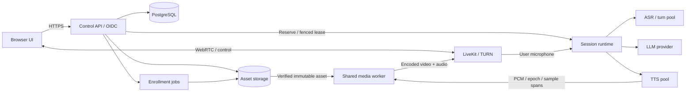

# End-to-end implementation specification

Revision: 2026-10-26. This is the required **complete product scope**, not an implemented application. It supplements the authoritative [build plan](../../V2_RESEARCH_AND_BUILD_PLAN.md). Research rationale and exact sources: [deployment research](DEPLOYMENT_RESEARCH.md). Build order: [implementation backlog](IMPLEMENTATION_BACKLOG.md). Release operations: [deployment specification](DEPLOYMENT_AND_RELEASE.md).

Model defaults follow [independent quality evidence and Q0](MODEL_QUALITY_BENCHMARKS.md). The current project target is deployable research: NC models may be primary providers, with commercial clearance deferred. Profile authorization checks enforce actual research access and consent; they must not reject a research session solely because commercial use is unavailable. Maintain separate `engineering_qualification` and `distribution_scope` fields in release/model manifests. Quality, latency and memory results belong to the same identified profile.

**Implementation decision:** Qwen3-TTS Base 1.7B is selected now; follow [P00–P09](IMPLEMENTATION_PHASES.md). Other TTS families are deferred. Quality qualification does not require repeating model selection before coding.

## 1. What finished means

A fresh operator can provision verified artifacts, start the documented stack, enroll or import an authorized avatar/voice, open the browser, hold an interruptible audiovisual conversation, recover from a temporary disconnect, revoke the asset, inspect redacted diagnostics, and upgrade or restore the service using the supplied runbooks. Every step must work with real selected providers and actual playback, not only mocks or a generated MP4.

Release profiles are explicit:

| Profile | Required result | Claims it cannot borrow |
|---|---|---|
| Functional reference | Offline-capable after provisioning; synthetic/cleared mesh fixture; real local speech adapters; browser and local output | Does not establish photorealism |
| Photorealistic local | Consented fitted rig/Gaussian asset, verified speech/motion providers, one qualified 16 GB host profile | Does not imply every provider fits together or hosted concurrency |
| Hosted production | Authenticated multi-tenant service, measured admitted capacity, rights manifest, durable enrollment, recovery/operations | Does not inherit cloud-provider guarantees automatically |
| Client-rendered extension | Qualified devices and downloadable assets with explicit rights | Does not apply to private server-only biometric assets |

The reference fixture is an independently authored synthetic rig and procedural audio for contract tests; the real speech path also needs a legally distributable voice/reference. The photorealistic release needs at least three consented identities and the original quality gates. An audio-only fallback is a degraded mode, not completion of photorealistic scope.

Required product functions: device selection and microphone test; persona/voice/avatar selection; visible consent and generated-avatar disclosure; start/stop/mute/interruption; captions with partial/final distinction; connection/quality state; enrollment upload and progress; preview/approve/version/rollback; asset deletion/revocation; operator health, session count and capacity diagnostics. Keep tools/RAG, telephony, billing, arbitrary plugins and avatar marketplaces outside the first release. Their absence must not leave holes in the core conversation path.

## 2. Concrete stack and process topology

- **Web:** React + TypeScript + Vite static client, LiveKit browser SDK. No SSR requirement. Same-origin API through the edge proxy; mobile browser support qualified explicitly.
- **Control API:** FastAPI, typed request/response models, OpenAPI export, SQLAlchemy/Alembic and PostgreSQL. Use one database engine in local/server profiles to avoid separate migration semantics. Session cookies and an OIDC integration for hosted login; a loopback-only development identity mode that refuses public binding.
- **Session runtime:** project-owned asynchronous actors and capability-tested provider adapters. One actor owns each conversation. LiveKit Python RTC handles microphone subscription and application control for the baseline; selected provider plugins may be adapted without surrendering epoch/clock ownership.
- **Speech pools:** bounded CPU ASR/turn workers, a dedicated selected-Qwen GPU worker, initially CPU llama.cpp or explicitly configured remote LLM, and separate server GPU pools where needed. Providers never initialize a whole model inside each session actor. Measure aggregate Qwen/media VRAM before colocating a GPU LLM.
- **Media worker:** Python/PyTorch/gsplat reference plus a native extension owning conversion, NVENC and LiveKit C++ publication. Keep GPU render tensors in this process; expose narrow handles/events with retained lifetimes. The native layer publishes both avatar audio and video under one media participant and a common timeline.
- **LiveKit:** one self-hosted instance for local/reference deployment; distributed nodes and Redis only when required. The framework does not decide GPU admission. Neither ingress nor egress recording is mandatory.
- **Durable metadata:** PostgreSQL; file-backed blob interface locally, S3-compatible object storage in hosted deployments. Select/qualify the actual object-store implementation and license during packaging; do not silently install a storage product.
- **Enrollment:** separate durable worker and GPU allocation. Database job records with leases and idempotent stages; no Kafka/Temporal requirement initially.
- **Telemetry:** OpenTelemetry traces/metrics, Prometheus-compatible export and an optional collector/dashboard profile. Public endpoints do not expose model paths, identities or prompts.

A session uses three logical participants: browser user, session controller (microphone subscriber/control), and media publisher (avatar audio/video). Grant each only required capabilities and subscribe to explicit identities/tracks to avoid self-ASR. The media worker can host several media participants while sharing weights/immutable assets. This split costs connections but avoids duplicating GPU state and allows the Python baseline publisher to be replaced by native output without replacing turn logic. Consolidation is optional after parity tests.

## 3. Session startup and full conversation flow

1. Browser loads public capabilities, obtains application authentication, chooses only authorized ready asset revisions, and completes a user-initiated microphone/playback preflight.
2. `POST /v1/sessions` includes an idempotency key, avatar/voice revisions, profile, locale and client capabilities. The API validates rights, quotas and profile support before reserving capacity.
3. Admission atomically reserves a slot and memory estimate against a worker lease. Worker preparation verifies hashes, loads/pins assets and reports actual ready capabilities. Persist the chosen versions; never silently substitute an unrelated voice/model.
4. API creates a unique room generation and restricted participant grants. `PREPARING` is distinct from `READY`. Tokens are returned only when the selected profile is ready; a cold preparation timeout yields a typed failure and releases the reservation.
5. Browser joins, starts microphone publication and subscribes to the approved media participant. Controller receives audio with capture/transport clock metadata, streams ASR, and publishes captions/turn state. Input capture continues during avatar speech with the played-output AEC reference.
6. Turn commitment produces bounded useful text segments. TTS streams native-rate audio, the sample ledger resamples statefully, and the media worker generates articulation, composes behavior and renders ahead for scheduled presentation. Audio and video start only when the aligned horizon is ready.
7. Browser reports observable playback events and uncertainty. History marks approximate or confirmed presented words; it must not claim exact word delivery when alignment metadata is unavailable.
8. Intentional interruption immediately gates local output, advances the server epoch and cancels upstream work. Resume only after the receiver-safe boundary defined below. Corrections replace superseded turns.
9. End/timeout/revocation closes tracks, releases pinned session state and GPU reservations, cancels pending work and records a redacted outcome. Source assets remain immutable unless a deletion job owns their removal.

Session lifecycle: `REQUESTED → RESERVED → PREPARING → READY → ACTIVE → DRAINING → CLOSED`; failure/cancel may transition from any nonterminal state to `FAILED/CLOSED`. This resource lifecycle is separate from the within-session speaking/listening state machine in the main plan.

## 4. Control API contract

All `/v1` endpoints use typed schemas, bounded payloads, opaque IDs and tenant authorization. Server-derived tenant identity cannot be overridden by request fields. Mutations use request IDs and idempotency keys; the same key/body returns the original outcome, while a changed body returns conflict. Store operation state long enough for retry windows, initially 24 hours. Durations below are defaults to qualify, not observed performance.

| Endpoint | Required semantics |
|---|---|
| `GET /v1/capabilities` | Available profiles/locales/providers and required client features; no secrets or internal paths |
| `GET /v1/assets` | Authorized ready/revoked versions, supported views and permitted deployment modes; paginated |
| `POST /v1/uploads` | Purpose, size/hash/type and consent reference; constrained upload grant, initially 15-minute expiry |
| `POST /v1/uploads/{id}/complete` | Verify object size/hash and decoding limits; enqueue validation exactly once logically |
| `POST /v1/enrollments` | Frozen input manifest, recipe/profile and rights scope; returns durable job ID, not a held-open inference request |
| `GET /v1/jobs/{id}` | Stage, progress, retryability and redacted reason; avoid fabricated percentage estimates |
| `POST /v1/jobs/{id}/cancel` | Idempotent stop request; results cannot become published after cancellation |
| `POST /v1/assets/{id}/approve` | Authorized review of an evaluated immutable revision, with evaluation/provenance references |
| `POST /v1/assets/{id}/revoke` | Immediately deny new use, stop affected sessions, initiate cache purge/deletion workflow |
| `POST /v1/sessions` | Reserve/prepare one session; `202` if preparing, `201` if ready; returns status URL |
| `GET /v1/sessions/{id}` | Lifecycle, selected revisions/profile and recoverable failure; room grant only to authorized caller |
| `POST /v1/sessions/{id}/join-grant` | Revalidate authorization and lifecycle, issue short-lived room/identity-scoped credentials |
| `POST /v1/sessions/{id}/controls` | Typed stop/interrupt/mute/config request with sequence and expected epoch; HTTP fallback for control transport |
| `POST /v1/sessions/{id}/close` | Idempotent close; release resources even if browser already disconnected |
| `GET /v1/sessions/{id}/events` | Bounded SSE status/caption stream with sequence-based reconnect; no PCM/frame payloads |
| `GET /health/live`, `GET /health/ready` | Process health versus selected-profile readiness; restricted detailed diagnostics separately |

Use `401/403` for authentication/authorization, `409` for version/state conflicts, `422` for invalid assets/configuration, `429` for tenant quota, and `503` for exhausted/unready capacity with bounded retry guidance. An API acknowledgment is not a playback acknowledgment. Events carry session, generation epoch, lease fence, monotonic source clock and schema version where applicable. Webhooks are verified and deduplicated; never let a duplicate leave event close a newer room generation.

## 5. Durable state and job semantics

Minimum tables (every resource row tenant-scoped): `principals/memberships`, `assets`, `asset_revisions`, `consent_records`, `uploads`, `jobs/job_attempts`, `sessions`, `worker_leases/reservations`, `idempotency_records`, `outbox_events`, and `audit_events`. Model registry records include source/hash/license, runtime compatibility and validation profile. Keep secrets and raw biometric payloads outside database rows.

Asset revision rows reference immutable content-addressed objects, rig/basis hashes, parent revisions, evaluation report and allowed uses. Publishing changes a pointer transactionally; it never edits a running session's asset in place. Each session pins its version until close unless revoked. Local file paths are generated by the storage adapter, not accepted from clients.

Enrollment stages: `intake → validate → preprocess → fit → export → evaluate → review → publish`. Each stage consumes immutable inputs and writes to an attempt-specific staging prefix. A successful transaction records output hashes and the next state; retries can reuse valid completed outputs. Use short database claim transactions, then release the lock during long GPU work. Lease heartbeat and fencing prevent a stale attempt publishing after another worker takes over. A temporary worker failure retries at most three times with backoff; invalid input, consent failure and license failure are terminal until corrected. Queue semantics are at-least-once with idempotent side effects, not fictional exactly-once execution.

A revocation tombstone wins over concurrent job completion. Recheck asset/consent generation at publication and at worker attach. Deletion traverses derived assets, replicas and cached voices; maintain a receipt with completed and pending locations. Backups have a declared retention and tombstone replay so restoration cannot revive revoked assets. A client-downloaded model cannot be remotely erased reliably; this limitation is disclosed before enabling client distribution.

## 6. Worker RPC and shared-state contract

Use gRPC/protobuf across process boundaries that need streaming, with the same typed semantics in-process. The HTTP API handles product lifecycle; it does not carry per-frame tensors. A selected provider may have its own HTTP/WebSocket protocol behind an adapter.

Required worker operations: `DescribeCapabilities`, `Reserve`, `PrepareSession`, `OpenStream`, `CancelEpoch`, `DrainSession`, `ReleaseSession`, `Health`. `Reserve` returns lease ID, monotonically increasing fence, expiry and admitted profile. Retries never create a second owner. Every state-changing message includes the fence; stale fences are rejected. The media worker also rejects stale generation epochs within a valid lease.

Initial proposed lease behavior: heartbeat every 2 seconds, expiry after 10 seconds; workers stop accepting new work immediately on drain and stop serving a lease they can no longer renew before its local conservative expiry. These control values are not audio timing constants. Native publication checks the conservative lease expiry independently of a blocked Python actor; an expired owner cannot keep sending buffered frames/audio. Use coordinator time plus measured clock uncertainty/remaining TTL, not cross-host monotonic timestamps directly. A replacement cannot publish until the old lease is expired/fenced and the old media participant is removed. Fail closed on ambiguous ownership rather than permitting two audible avatars.

Streaming RPCs have bounded credits expressed as sample milliseconds or frames. Distinguish logical deadlines from transport keepalive. Cancel bypasses ordinary media queues and receives an acknowledgment of stopped work plus remaining unavoidable output. Native encoder/surface cleanup may finish asynchronously without allowing stale publication. Worker crashes terminate affected sessions or re-establish a new epoch/room; they do not transparently replay unfinished words.

No database writes occur per audio chunk or render frame. Persist lifecycle, configuration and optional conversation checkpoints asynchronously. Default transcript retention is off; recovery may resume an empty context with a clear notice unless retention was explicitly enabled.

## 7. Native media integration and fallback

First native spike: LiveKit C++ SDK v1.11.0 (or a subsequently qualified pinned revision) with external NVENC and the selected CUDA/gsplat environment. The tagged CMake file specifies C++17 and CMake 3.20 minimum; pin its Rust/FFI and other transitive build requirements too. [Tagged build definition](https://github.com/livekit/client-sdk-cpp/blob/v1.11.0/CMakeLists.txt). The Python baseline remains an explicit-copy reference, not the final native path.

The native module owns preallocated CUDA conversion/output surfaces, NVENC sessions and serialized encoded-source publication. PyTorch/gsplat produces a device tensor with a retained owner; a CUDA event fences conversion. Encoder completion fences reuse. Send one complete H.264 access unit with matching timestamp/dimensions; include decoder parameter sets at IDR boundaries and honor keyframe/congestion feedback. Copying the small encoded bitstream to the SDK is permitted and measured. Do not read raw RGB back to host in the qualified GPU path.

Keep the 300–500 ms generated PCM horizon in application-owned cancelable storage, not an extra transport prebuffer. Initially qualify a 40–80 ms sender audio queue and record the actual receiver buffer; lower queue depth must also pass underrun tests. Publish avatar audio/video in the same participant with a coherent source clock mapping. Avoid B-frames and encoding lookahead in the reference profile. Disable unimplemented simulcast; begin with one layer and measured bitrate/FPS adaptation. If resolution or codec changes require republishing, send an explicit profile transition and establish a new track mapping. Encoder failure chooses a qualified lower profile or audio mode; it must not loop allocating replacement encoders until OOM.

GStreamer LiveKit source/sink is the first fallback, WHIP without transcoding the next compatibility option. Select one after a bounded spike; document why. Neither is a reason to build a custom SFU. Measure timestamp preservation, keyframe recovery, cancellation, repeated attach/detach, raw-frame readback and CPU/GPU load before selection.

## 8. Browser playback, interruptions and accessibility

Require a user gesture for session start, then request the microphone and unlock audio playback. Show actionable states for denied permission, no device, insecure origin, autoplay block, ICE failure and unsupported codec. Preserve a typed text-input fallback and captions; keyboard-accessible stop/mute controls remain available during loading/errors. Show whether microphones are active and whether recording is enabled. Do not put CUDA/model debugging into normal user flows.

Use one audiovisual playback association per avatar publisher and attach only the authorized track identities. Correlate frame IDs/PTS where available, sample receiver stats and use video presentation callbacks as observations with uncertainty. Browser native RTP/audio buffering is not exposed as an exact application-controlled sample queue. Optional client rendering must separately prove its audio clock mapping; video metadata alone does not solve it.

**Cancel-resume protocol:** local intentional interruption mutes the avatar immediately; server acknowledges a new epoch after rejecting old text/audio/motion. Do not unmute solely on that acknowledgment: old packets may still reside in decoder/device buffers. Qualify a receiver-safe boundary using a tested transport-specific method. The conservative fallback detaches/unsubscribes the old media tracks and binds newly published track IDs for the new epoch, starting with neutral video and fresh audio. Old track callbacks are rejected by ID. A replacement track has a newly mapped source clock/SSRC; ordinary epoch changes on an existing track preserve its RTP clock. Measure resulting resume delay, negotiation and repeated interruption cost. If neither a proven flush nor track replacement meets product constraints, the browser profile fails the interruption gate; do not claim the internal epoch alone fixes it.

AEC uses the actual played reference. Backend ASR subscribes only to user microphone; avoid multiple uncoordinated echo cancellers. Test headset and loudspeaker paths, Bluetooth delay, device change, tab backgrounding and sleep/wake. Recovery from disconnect retains a session only within a bounded grace window (initially 30 seconds), then tears down resources. Rejoin revalidates rights, issues a new playback mapping and never replays old queued speech. A page refresh may need another user gesture.

## 9. Authorization, isolation and revocation

Hosted login uses an established OIDC provider; application cookies are Secure/HttpOnly with CSRF protection for mutations, strict origin policy and no tokens in URLs/logs. Development auth is loopback-only, visibly labeled and forbidden by production configuration validation. Role distinctions: user/session owner, avatar reviewer and operator; being an operator does not automatically grant access to biometric recordings.

Room grants scope room generation, participant identity, publication/subscription/data permissions and short validity (initial proposed join TTL: two minutes). Issue separate controller/media grants; never expose SFU API secrets to browser or model workers. Authenticate internal RPCs with service identity/mTLS in hosted deployment; local sockets use filesystem permissions.

Self-hosted LiveKit token expiry is not active-session revocation, and kicked users may hold still-valid/reconnect tokens. Application revocation stops the publisher and session, denies new grants, closes the room generation and ejects rejoining participants. Never reuse the revoked room for new sensitive media. Webhooks reconcile membership, but cannot substitute for stopping the source. Verify the exact deployed SDK/server token refresh behavior. Strong instantaneous prevention of all rejoin attempts requires a separately qualified authorization enforcement mechanism; do not claim it from short TTL alone.

WebRTC encryption protects transit; backend inference must access speech. Do not claim that SFU E2EE hides media from an inference worker that holds decryption keys. Recording is opt-in, defaults off, and has separate storage/retention/access grants. API rate limits apply to grants, uploads, sessions and job creation; input decoding and model adapters have resource/time bounds. Remote provider endpoints are operator-configured allowlists, not user-controlled fetch URLs.

## 10. Compatibility and release contracts

Support one current and previous minor contract version during rolling deployment, with explicit capability negotiation. Reject unsupported major schema versions. Unknown optional fields can be ignored; unknown required semantics fail closed. Asset schema and model/rig basis are independently versioned. Upgrading a provider creates a new evaluated profile; it does not mutate running sessions.

A release manifest binds application/UI/API/native SDK, container digests, model hashes, asset schema, migration range, licenses and passed acceptance reports. The functional fixture, photorealistic assets and hosted profile have separate evidence. The complete release gate includes real browser conversation, enrollment/revocation, unauthorized access tests, forced TURN, cold start, admitted concurrency, worker failures, drain/rollback and backup restore. Detailed tasks and evidence IDs follow in the backlog and deployment specification.
