# V1 implementation audit

Audit date: **2026-10-25**. Repository baseline: `54b4f171a9bb193a6b648b8015fba6ba295368f0`.
Companion to [the authoritative V2 plan](../../V2_RESEARCH_AND_BUILD_PLAN.md).

## Scope and evidence

The audit inventoried the first-party Python modules, tests, scripts, documentation, dependency declarations, local checkpoints, and the vendored GaussianAvatars/VHAP trees. Detailed tracing covered the live call graph, preprocessing/export/training paths, deformation/rasterization interface, and relevant vendor CUDA boundaries. Third-party GLM headers, generated binaries, and every line of external utility code were not individually reviewed; this is an architecture audit, not a security certification of all vendored code.

Source references below are relative to this baseline. Documentation and historical training summaries are claims until supported by code or a recorded experiment. V1's internal “v2” MotionTranslator checkpoint label is unrelated to this project redesign.

Pre-existing changes were `D data/README.md`, `D output/README.md`, and untracked `.git-empty-master-backup/`. They were left intact. No model was downloaded, trained, converted, or rewritten during the audit.

### Actual environment and artifacts

| Item | Observation |
|---|---|
| GPU | RTX 4070 Ti SUPER, 16,376 MiB reported, driver 580.178.04 |
| CPU | Ryzen 5 7600X, 6 cores / 12 threads |
| System runtime used for probes | Python 3.14.4, torch 2.10.0+cu128, CUDA 12.8, transformers 5.2.0; exact versions in JSON |
| Repository `.venv` | Python 3.14.3, missing core ML dependencies; not a working V1 environment |
| Other user-site packages | torchaudio 2.10.0, chatterbox-tts 0.1.7, numpy 2.4.1, pytest 8.4.2, llama-cpp-python 0.3.21, pyvirtualcam 0.15.0 |
| Missing imports encountered | iopath, plyfile, tyro; rasterizer/simple-knn not installed as distributions |
| Present translator checkpoints | Two `best_model.pt` files, each 134,858,485 bytes; both fail current strict loader |
| Present research assets | GaussianAvatars media/306 PLY (~22.4 MB) and FLAME sequence (~69.7 MB); old FLAME2023 assets; cached HuBERT and Chatterbox |
| Missing working directories | `data/` and `output/` absent; ARTIFACTS.md describes historical assets, not current availability |
| Full conversational benchmark | Not possible without repairing dependencies/assets; not attempted with substituted fake models |

The two checkpoint configurations specify 1024 audio dimensions, 100 expression coefficients, 3 jaw dimensions, and causal attention. Historical summaries record 80/100 training epochs and losses around 0.784/0.662. These are neither comparable perceptual-quality scores nor proof of a valid temporal holdout. Asset filenames are not evidence of consent or redistribution rights.

## Live data flow

```mermaid
flowchart LR
  Mic["sounddevice: 2 s block"] --> Buffer["5 s rolling audio"]
  Buffer --> ASR["Whisper pipeline every 2 s"]
  ASR --> Dedupe["string overlap removal"]
  Dedupe --> Transcript["shared transcript"]
  Transcript --> LLM["whole Gemma response"]
  LLM --> Text["text queue"]
  Text --> TTS["Chatterbox sentence generation"]
  TTS --> Fanout["independent queue fanout"]
  Fanout --> Playback["blocking sounddevice write"]
  Fanout --> Bridge["40/80/200 ms paced bridge"]
  Bridge --> HuBERT["full .8/1 s HuBERT window"]
  HuBERT --> Motion["Transformer; last frame; EMA"]
  Motion --> CPU["CPU numpy motion"]
  CPU --> State["latest motion + manual delay"]
  State --> Render["FLAME + Gaussian CUDA rendering"]
  Render --> Host["float RGB GPU-to-CPU"]
  Host --> Vcam["resize/I420/virtual camera"]
  Host --> Preview["JPEG file / MJPEG"]
```



There are threads, but a turn still waits on a long chain of coarse work units. Threads are not evidence that GPU execution or conversational processing overlaps effectively.

## Component decisions

| Component | Decision | Evidence and migration implication |
|---|---|---|
| Microphone capture | **Replace** live path | 2 s callback block and polling cadence preclude reliable sub-second replies. Use 10–20 ms frames, device timestamps, bounded ring buffer, AEC and VAD. |
| Whisper window transcriber | **Replace** default; retain offline baseline | Full rolling-window ASR and string deduplication have no partial/final revision semantics. A streaming ASR adapter must own decoder state. |
| Gemma model integration | **Retain** provider concept; **replace** orchestration | llama.cpp is useful locally. Runtime calls non-streaming completion; helper streaming code is unused. Model identity becomes configuration. |
| Transcript/persona utilities | **Optimize / migrate** | Keep useful cleaning and persona tests; replace token-budget and concurrency assumptions with session-owned state and bounded context. |
| Chatterbox wrapper | **Replace** fast path; retain quality comparator | Actual original Chatterbox class lacks generate_stream in installed source. “Streaming” fallback produces whole sentences. |
| TTS queues/audio bridge | **Replace** | No end-of-stream flush, timeline, cancellation epoch, or duration-based backpressure. Arbitrary chunk dropping loses words and alignment. |
| HuBERT | **Retain** frozen offline comparator; **replace** production extraction | Reprocesses context. Warm cost is modest locally, but feature training/inference context mismatch and session multiplication remain. |
| MotionTranslator | **Retain** historical experiment; **replace** default | Loader incompatibility confirmed, no positional encoding/cache, limited speaker-specific labels. Preserve original checkpoints; explicit importer only. |
| FLAME contract | **Replace with versioned rig contract** | Old FLAME2023 and FLAME2023Open are distinct assets/bases/licenses. No silent truncation or coefficient reuse. |
| VHAP preprocessing | **Retain** research-only path | Valuable calibration/export reference; current license/dependencies unsuitable as an assumed unrestricted shipping dependency. |
| GaussianAvatars | **Retain/optimize** research baseline; renderer replacement conditional on Q0 | NC code/rasterizer remains research-eligible. Training-oriented state and full-sequence GPU residency require isolation/optimization. October 26 policy revision: native renderer migration follows quality validation; commercial clearance is later work. |
| GeoAvatar-style additions | **Remove** from default | Partial implementation, hidden state and resume/export mismatches; no reproduced benefit. Reconsider only as isolated ablations. |
| Idle/blink/gaze controller | **Retain** state-machine idea; **replace** coefficients/behavior | PCA axis is not an eyelid control; sine-wave gestures do not encode conversational intent. |
| Single renderer owner | **Retain / strengthen** | Good ownership boundary. Add explicit GPU scheduling, surfaces, fences and presentation timestamps. |
| CPU RGB frame export | **Optimize** interim; **replace** server path | Quantize before copy for CPU sinks; keep server rendering/encoding on GPU. |
| Virtual camera | **Retain** optional sink API | Preserve letterboxing tests; derive timing from audio clock, add virtual microphone pairing and explicit copy boundary. |
| Local runtime HTTP/tmux UI | **Retain** local debugging only | No production auth/session isolation. Replace deployment control plane, retain useful operator controls behind auth. |
| Tests | **Retain and extend** | Small pure tests useful; mocked paths do not establish model/driver compatibility or real-time behavior. |
| Shell scripts / environment | **Replace packaging**, retain documented provenance | Hardcoded host paths, incompatible dependency eras, and unpinned downloads require isolated environments and lockfiles. |
| Dataset/checkpoint history | **Retain immutably where lawful** | Inventory hashes, consent and license; import with explicit mappings; re-split by temporal segments before evaluating. |

## Findings by execution path

### A. Capture, ASR and turn-taking

**A1 — Structural latency floor.** [audio_listener.py](../../orchestrator/audio_listener.py), constructor, callback, and push loop (lines 19–79): default sample rate 16 kHz, rolling buffer 5 s, push_interval 2 s, blocksize = sample_rate × push_interval. An acoustic endpoint arriving just after a polling/callback boundary can wait roughly another interval before downstream work even starts. Relative callback/push scheduling and initial zero-filled buffers add variability. This is a static bound from code, not a measured distribution.

The callback allocates/concatenates arrays under a lock. The push loop copies the whole window and sleeps. Queue size 10 counts arrays, not media time; dropping an old window does not implement turn cancellation.

**A2 — RMS is not conversational endpointing.** [stt.py](../../orchestrator/stt.py) invokes a transformers Whisper pipeline on complete windows, rejects quiet audio, normalizes text, and removes overlaps. It has no turn hypothesis confidence, partial revision ID, committed word timestamps, semantic endpoint, echo reference, or distinct backchannel detection. A repeated sentence may be legitimate; string subset filtering can suppress it. A five-second window can cut a word at either edge.

**A3 — Echo and overlap.** Microphone capture and synthesized playback operate independently. Without AEC the system can transcribe its own speaker output. There is no coherent arbitration for two simultaneous human speakers or for user speech during avatar playback. Muting/control-file flags do not solve acoustic echo or full-duplex semantics.

### B. LLM and transcript

**B1 — Complete response precedes TTS.** [run_demo.py](../../run_demo.py), `_generate_gemma_output` at 569 and `handle_participant_text` at 925: llama.cpp `create_chat_completion` is called without streaming; the HF fallback also completes `generate` before returning. [gemma_loader.py](../../orchestrator/gemma_loader.py) contains `stream_gemma_with_early_tts` at 404, but that is not this live path. README/planning claims about early sentence audio must not be treated as implemented latency behavior.

**B2 — Model identity and capabilities differ from historical plans.** Live loading prefers GGUF/llama.cpp. Native multimodal/audio generation input construction is a stub, not verified Gemma audio orchestration. Model selection must declare its actual backend, tokenizer, context, chat template, and capability set.

**B3 — Context limits and ownership.** [transcript.py](../../orchestrator/transcript.py) defaults to a very large token budget relative to the default 4096-token GGUF context. The model also needs completion headroom and system/tool tokens. Repeated whole-history tokenization and old-entry removal are avoidable work. The stdin and microphone paths can both mutate transcript/model state; neither is the sole session actor. Use one turn owner and per-session provider state.

**B4 — Parsing versus speech emission.** Tool/emotion cleanup utilities and their tests are useful, but parsing a complete response to discover speech/emotion delays everything. Stream speech text and typed control events separately. Never speak partial JSON or special control tokens.

### C. TTS, playback and bridge

**C1 — Class/API mismatch.** [synthesizer.py](../../tts_engine/synthesizer.py) imports `chatterbox.tts.ChatterboxTTS`, although surrounding descriptions mention Turbo. `hasattr(generate_stream)` chooses streaming only if provided; otherwise sentence-by-sentence `generate` runs. The installed original-class source has no `def generate_stream`. This probe inspected code and did not synthesize speech.

**C2 — Chunk boundaries are not a streaming guarantee.** Splitting a fully generated waveform into arrays reduces transport granularity but not time to first sound. `chunk_size` is meaningful only in a supported generator API. Contract tests must require the first playable PCM before full utterance completion.

**C3 — Redundant transfers and resampling.** Model tensors are copied to CPU numpy, wrapped again as CPU torch tensors, resampled independently from hardcoded 24 kHz to 16 kHz, and converted back. Per-chunk resampling resets filter history and can create boundary artifacts or sample-count drift. Playback should retain native-quality PCM; provide a stateful 16 kHz branch only for a model needing it.

**C4 — Audio loss under overload.** TTS and fanout queues evict old chunks independently. Different consumers can hear/animate different portions of the utterance. Audio must be backpressured or the entire generation explicitly cancelled; silently deleting words is invalid.

**C5 — Tail loss.** [audio_bridge.py](../../tts_engine/audio_bridge.py), `feed_loop`, emits only complete chunks. A remaining buffer smaller than the configured hop is not flushed by an EOF event because no EOF event exists. Queue-empty is not EOF. The bridge also paces inference with its own monotonic deadline, separate from actual sound-device presentation.

**C6 — Playback clock absent.** [run_demo.py](../../run_demo.py), `AudioPlaybackOutput` at 413, blocks on sounddevice stream writes; fanout at 475 sends arrays without timestamps. Manual motion/audio delay can compensate one observed configuration but not startup buffering, drift, interruption, or device latency changes.

### D. Audio encoding and motion

**D1 — Repeated HuBERT inference.** [inference.py](../../audio_driver/inference.py), `StreamingAudioBuffer.push` and both step methods: a CPU `torch.cat`, full clone, transfer to GPU, complete HuBERT pass, complete transformer pass, final feature selection. A 1 s window every 80 ms re-encodes 12.5 audio-seconds per real second; 0.8 s every 40 ms re-encodes 20. These ratios describe input overlap, not measured FLOP multipliers.

**D2 — “Causal-compatible” is not a stateful causal encoder.** [audio_encoder.py](../../audio_driver/audio_encoder.py) loads bidirectional HuBERT-Large. It sees only audio available in its current buffer, but earlier features change with new context and a causal mask downstream does not make them equivalent to offline features. Training uses disjoint 10 s encoder blocks; inference uses a much shorter left window. Reusing an arbitrary KV cache in bidirectional HuBERT would change its function. Any causal replacement needs matched feature training and quality evaluation.

**D3 — Unused hop and oversize warmup.** Buffer `hop_size` is metadata rather than scheduling logic. Pushing 16,000 warmup samples into a 12,800-sample context produces a 16,000-sample buffer in the actual probe. Subsequent concatenations preserve the wrong length. V2 rings must reject oversized pushes or deliberately retain exactly the final capacity.

**D4 — Transformer limitations.** [motion_translator.py](../../audio_driver/motion_translator.py) uses four 1024-dimensional encoder layers, 8 heads, FF dimension 2048 by default; 33,709,159 unique parameters were counted. No explicit time/position embeddings or persistent state appear. All outputs are computed and all but the last dropped. Regression and EMA encourage smoothness but cannot identify the many plausible listening/head gestures from speech alone.

**D5 — Confirmed checkpoint regression.** The module registers heads under `heads.expr/jaw` and aliases `expr_head/jaw_head`. Existing files only contain the older head keys. `MotionTranslator.load(..., weights_only=True)` fails for both local checkpoints with eight missing `heads.*` keys. Aliasing attributes does not migrate a state dictionary. Future import should map exact tensors to both required names, validate all shapes and evaluate numerical parity; do not use `strict=False` to conceal missing learned weights.

**D6 — Incomplete serialization.** Save configuration omits n_layers, n_heads, ff_dim and dropout. Nondefault models cannot reliably round-trip. Save schema version, full architecture, rig basis/hash, feature extractor revision, training sample rate/window/lookahead, normalization, and output semantics.

**D7 — Timings stop too early.** `_last_latency_ms` is set before host reads / CUDA completion. The built-in benchmark has no warmup exclusion and uses these values. GPU kernels are asynchronous, so that counter is not completed service time. Our separate probe synchronizes after each sample.

**D8 — Motion channels need semantics.** Width coercion pads/truncates arrays silently. Training loads tracked rotation/translation values, while the live renderer adds deltas to base pose. A model output trained as absolute pose can be applied twice. Axis-angle/radians, coordinate system, origin, neutral reference, and absolute/delta convention must be explicit and incompatible schemas rejected.

### E. Preprocessing and training

Relevant sources: [preprocess_data.py](../../scripts/preprocess_data.py), [prepare_avatar_training_source.py](../../scripts/prepare_avatar_training_source.py), [train_audio_driver.py](../../scripts/train_audio_driver.py), [VHAP tracker](../../VHAP/vhap/model/tracker.py), [VHAP exporter](../../VHAP/vhap/export_as_nerf_dataset.py), [Gaussian training](../../GaussianAvatars/train.py).

**E1 — Synchronization by length interpolation.** `encode_audio_with_hubert` concatenates features from 10 s blocks; convolutional edge effects change frame counts. `resample_sequence_to_length` and FLAME-index-to-feature-index conversion align sequence lengths, not original capture timestamps, start offset, codec delay, or dropped frames. A numerically aligned array can remain perceptually misaligned.

**E2 — Leakage-prone splits.** `build_split_indices` takes the minimum and maximum mapped indices as a contiguous range. Holes and originally disjoint frames are lost. A camera holdout in a multiview VHAP dataset is not a motion-time holdout: identical timepoints can enter both train and validation. If validation is absent, the script uses a test split for selection. Overlapping temporal windows need guard intervals at least as long as context plus lookahead.

**E3 — Feature-cache identity insufficient.** Path, length and frame count do not identify audio contents, model revision, preprocessing or encoder chunking. Renaming/correcting a source or changing dependency/model behavior can reuse stale features. Hash the actual bytes and complete preprocessing contract.

**E4 — Resource lifecycle.** Encoder initialization/cache construction is part of a training function and can leave the GPU encoder resident when the translator starts training. Release it deliberately or separate preprocessing into a process whose exit releases all memory. Offline optimization and live serving should never contend unintentionally.

**E5 — Enrollment failure handling.** Current shell pipelines, tracking resume/monitor scripts and export helpers are useful operational history, but success criteria often depend on file existence or iteration numbers. V2 stages require checksummed outputs, finite-value/camera/topology checks, failed-frame reports, and resumable manifest states. “Video prepared” is distinct from “tracked accurately” and “avatar passed held-out rendering.”

### F. Rendering and deformation

**F1 — Full sequence residency.** [avatar_renderer.py](../../avatar_renderer.py) and [flame_gaussian_model.py](../../GaussianAvatars/scene/flame_gaussian_model.py) retain FLAME arrays for all tracked timesteps on CUDA, including dynamic offsets. Live inference primarily needs a canonical identity and current state. Expression PCA further downloads historical arrays to CPU and computes an SVD. This is startup/VRAM cost unrelated to per-frame identity rendering.

**F2 — CPU round trips.** Motion results become CPU numpy and are uploaded again per channel. Returned images at line 293 are float32 RGB on GPU, permuted/clamped, copied to CPU, then scaled/cast to uint8. At 512² this transfers ~3 MiB instead of ~0.75 MiB/frame; at 30 FPS, ~90 versus ~22.5 MiB/s, before other copies. This bandwidth alone is not catastrophic on PCIe, but synchronization and multiplied sessions matter. Probe results below quantify only the conversion.

**F3 — Allocation/default-device problems.** Small zero tensors and intermediate FLAME tensors are recreated. Vendor code uses hardcoded `.cuda()` in several paths; a wrapper's device argument does not establish multi-GPU safety. Training rasterizer helpers still allocate gradient-oriented state. Trace shared accessors and kernels before assuming caching or in-place changes are safe.

**F4 — Topology corruption masked as compatibility.** PLY/FLAME loading truncates a mismatched vertex count and clamps invalid binding face indices to the last valid face. It can produce plausible-looking but anatomically wrong deformation. Reject topology mismatch; a migration needs explicit vertex/face remapping and neutral-pose parity checks.

**F5 — Static dynamic offset and oral anatomy.** The live update reuses a base dynamic offset rather than modeling wrinkles/mouth-interior variation as a coherent expression-dependent field. Missing or misattached teeth and eye surfaces cannot be repaired with arbitrary expression scaling.

**F6 — GeoAvatar-style extensions are not verified reproductions.** [geoavatar_utils.py](../../GaussianAvatars/utils/geoavatar_utils.py) estimates adaptive scales in Python per-triangle loops with GPU scalar reads. “Mouth construction” selects existing teeth triangles; it does not implement a new complete palate/tongue model. Partwise deformation moves groups by centroid translation rather than preserving full jaw rigid rotation. Training switches at exact iteration numbers can be missed when resuming beyond a threshold; important flags/group metadata are not faithfully restored from ordinary PLY export. Do not attribute a paper's quality gains to these local approximations.

**F7 — Measurement boundaries.** Vendor FPS demos measure renderer-centric workloads. They exclude ASR, response generation, TTS, queueing, network and often video encoding. Their FPS cannot establish a conversational latency SLO.

### G. Animation, presentation and ownership

**G1 — Nonsemantic expression basis.** [runtime_animation.py](../../runtime_animation.py) overlays sinusoidal head/translation motion, random gaze, and a PCA expression direction for blinks. PCA axis order has no stable anatomical meaning; it can move the mouth during a blink. Head movement has no turn-taking or content signal. Preserve timing/state concepts, replace with a calibrated rig and separately bounded behavior controls.

**G2 — Latest state is not sample alignment.** `AvatarMotionState` records update times and holds/fades state; the pending-motion deque uses completion-related delays. Rendering selects the latest value, without interpolation by audio sample PTS. A frame's age therefore depends on inference/scheduler stalls. A 30 FPS renderer and 12.5/25 Hz motion can be sensible, but need defined sampling/interpolation.

**G3 — Device sinks.** [camera_output.py](../../virtual_camera/camera_output.py) has useful single-writer/latest-frame behavior, but CPU PIL resize, RGB→I420 conversion and another sending cadence. Latest-frame replacement is appropriate for stale video, not speech. Virtual camera lacks a paired virtual microphone clock contract.

**G4 — Debug preview on the critical path.** JPEG encoding/file writes in `PreviewFrameWriter` run from the render loop. The runtime UI polls the file/MJPEG. Move diagnostics to a low-priority sampled consumer; browser production transport needs WebRTC.

**G5 — Deployment boundaries.** [runtime_app.py](../../runtime_app.py) manages local subprocess/tmux/control files through a threaded HTTP server. It is an operator convenience, not a tenant-safe API. Production needs identity/authorization, bounded inputs, safe asset IDs rather than arbitrary paths, signed sessions, request limits and explicit resource ownership. Keep local tools loopback-only.

## Controlled probes: observed, narrowly scoped

Reproduce using [audit_probe.py](benchmarks/audit_probe.py). Raw environment/configuration and measurements: [local-audit-2026-10-25.json](benchmarks/local-audit-2026-10-25.json).

```sh
HF_HUB_OFFLINE=1 TRANSFORMERS_OFFLINE=1 /usr/bin/python3 \
  docs/v2/benchmarks/audit_probe.py --output /tmp/avatar-audit.json
```

One process, one GPU, synthetic zero audio/features, 512² random RGB, inference mode, two torch CPU threads, 10 warmups and 100 synchronized wall-clock samples. Other desktop processes remained present; GPU clocks were not locked. No rendered avatar, speech intelligibility or perceptual output was evaluated. These small-sample p99 values are descriptive order statistics, not robust production tail estimates.

| Operation | p50 ms | p95 ms | p99 ms | Peak allocated MiB |
|---|---:|---:|---:|---:|
| Current untrained translator, fp32, 49 features | 0.690 | 1.032 | 1.096 | 139.45 |
| V1 float32 RGB→CPU→uint8 export | 0.346 | 0.446 | 0.688 | 15.13 |
| Comparison GPU uint8→CPU export | 0.094 | 0.117 | 0.286 | 18.13 |
| Cached HuBERT FP16, 0.8 s CPU input | 4.054 | 4.299 | 4.355 | 635.15 |
| Cached HuBERT FP16, 1.0 s CPU input | 4.026 | 4.325 | 4.936 | 635.24 |

HuBERT cached loading took ~4.00 s in this process, with warm filesystem/cache conditions; this is not first installation or cold disk startup. HuBERT's unused CTC head was reported as unexpected during base encoder loading, consistent with loading the encoder from the fine-tuned checkpoint.

**Interpretation:** CPU export is a measurable but small single-session cost. HuBERT is not a multi-second bottleneck here. Repeated ~4 ms calls still consume about 50–100 ms of serialized service time per audio-second at the inspected cadences, before contention; this is an illustrative workload calculation, not measured GPU utilization or session capacity. The complete V1 path cannot be benchmarked successfully through the current checkpoint loader.

### Test evidence

Executed with offline flags and system Python:

- Seven targeted pure/mocked test modules: audio_driver_motion, runtime_animation, tts_audio_bridge, orchestrator_stt, orchestrator_transcript, tts_emotion_mapping, virtual_camera_output: **16 passed, two deprecation warnings, 0.99 s**.
- `python3 -m pytest -q tests`: **collection stopped with four errors**, missing iopath, plyfile and tyro. No full-suite pass is claimed.
- Existing tests do not exercise loading the actual saved translator checkpoints, even though both fail.
- Dependencies were not installed to force the suite green. Test failures are environment findings; they do not establish four implementation defects.

## Migration invariants

1. Freeze original weights, tracked captures, cameras and license/consent provenance. Never modify a historical artifact in place.
2. Build importers with explicit supported source schemas and reject unknown dimensions/bases. Old loader fixes are research adapters, not changes to the canonical V2 contract.
3. Recover transcript/text cleanup and virtual-camera shape tests, then add time/cancellation/lifetime tests at new boundaries.
4. Rebuild feature caches from original audio with timestamps and a real time-based holdout. Do not carry reported historical loss into V2 as a baseline score.
5. Treat old FLAME/VHAP/GaussianAvatars assets as research-only until their exact rights are cleared. New FLAME2023Open availability does not relicense old derived checkpoints.
6. Keep V1 commands runnable in a separate legacy environment. New services must not import vendor modules through global sys.path mutation.
7. Establish a genuine visual baseline from a consented asset before changing the renderer, motion model and enrollment simultaneously.

